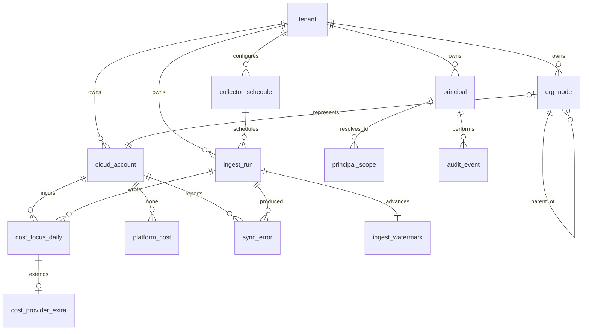

# Data model

Last updated: 2026-08-23
Update trigger: any schema change, in the same commit as the migration
Migrations: Alembic. See "Migration workflow" below
Canonical cost schema: FOCUS 1.1, ADR-0002

This document is the schema of record. A table that is not here does not exist,
and a column added without updating this document is an incomplete change.

## Principles

Six rules that shape every table below. They are not style preferences, each
one closes a specific failure this project has already reasoned about.

1. **Every table carries `tenant_id`**, including in a single tenant
   deployment. Adding it later means rewriting every query and every index. It
   is the cheapest insurance in the project.
2. **Every fact carries `as_of` and `collected_at`**, both `NOT NULL`. `as_of`
   is when the data was true at the source, `collected_at` is when Meter
   fetched it. Conflating them makes a stale number look fresh. ADR-0012.
3. **Invariants are constraints, not conventions.** If application code is the
   only thing preventing a bad row, the bad row will eventually exist. The
   idempotency key is unique in the database, not just in a Python function,
   because that is what holds when two workers race.
4. **Nothing cascades a delete onto history.** An account leaving the
   organization must not silently delete its cost records.
5. **Money is `NUMERIC(20, 10)`.** Never a float. FOCUS specifies decimal, and
   a float error compounds across a hundred million line items.
6. **Personal data is minimised, classified and retained by policy.** Every
   table is classified in `docs/09-DATA-CLASSIFICATION.md`, with a retention
   period and a scheduled job that enforces it. A column holding data about a
   person that no feature reads is not added.
7. **Timestamps are `TIMESTAMPTZ`, always UTC.** A billing period boundary in
   local time is a whole class of off by one day defects.

## Naming conventions

| Thing | Convention | Example |
| --- | --- | --- |
| Table | singular, snake case | `cloud_account` |
| Primary key | `<table>_id`, UUID v7 | `account_id` |
| Foreign key | `<referenced_table>_id` | `tenant_id` |
| Boolean | `is_` or `has_` prefix | `is_global` |
| Timestamp | `_at` suffix | `collected_at` |
| Enum column | singular noun, closed set enforced by a check constraint | `node_type` |
| Index | `ix_<table>__<columns>` | `ix_ingest_run__collector_status` |
| Unique index | `uq_<table>__<columns>` | `uq_ingest_run__idempotency_key` |
| Check constraint | `ck_<table>__<rule>` | `ck_org_node__type_valid` |
| Foreign key | `fk_<table>__<referenced>` | `fk_cloud_account__tenant` |
| Partition | `<table>_p<value>` | `cost_focus_daily_p2026_08` |

FOCUS columns keep their specification casing exactly, mapped to snake case
only where PostgreSQL requires it, and the mapping is recorded in the FOCUS
section below. ADR-0002 exists because the standard's value is that it is not
ours to improve.

## Entity relationship overview



## Tables

### Tenancy and identity

```sql
CREATE TABLE tenant (
    tenant_id       UUID PRIMARY KEY,
    name            TEXT        NOT NULL,
    created_at      TIMESTAMPTZ NOT NULL DEFAULT now(),
    CONSTRAINT uq_tenant__name UNIQUE (name)
);

CREATE TABLE principal (
    principal_id    UUID PRIMARY KEY,
    tenant_id       UUID        NOT NULL REFERENCES tenant(tenant_id),
    subject         TEXT        NOT NULL,   -- stable identifier from the identity provider
    display_name    TEXT        NOT NULL,   -- class P, anonymised after 90 days idle
    email           TEXT,                   -- class P, anonymised after 90 days idle
    tier            TEXT        NOT NULL,   -- viewer | analyst | owner
    is_global       BOOLEAN     NOT NULL DEFAULT false,
    created_at      TIMESTAMPTZ NOT NULL DEFAULT now(),
    last_seen_at    TIMESTAMPTZ,
    CONSTRAINT uq_principal__tenant_subject UNIQUE (tenant_id, subject),
    CONSTRAINT ck_principal__tier_valid
        CHECK (tier IN ('viewer', 'analyst', 'owner'))
);

-- A CACHE, never the source of truth. The source of truth is whatever
-- EntitlementResolver returns at authentication time. An entry without an
-- expiry would mean a revoked user keeps access, so expires_at is NOT NULL.
CREATE TABLE principal_scope (
    tenant_id       UUID        NOT NULL REFERENCES tenant(tenant_id),
    principal_id    UUID        NOT NULL REFERENCES principal(principal_id) ON DELETE CASCADE,
    account_id      TEXT,
    ou_id           TEXT,
    granted_via     TEXT        NOT NULL,   -- saml_role | ou_grant | global
    resolved_at     TIMESTAMPTZ NOT NULL,
    expires_at      TIMESTAMPTZ NOT NULL,
    CONSTRAINT ck_principal_scope__one_target
        CHECK (num_nonnulls(account_id, ou_id) = 1)
);
CREATE INDEX ix_principal_scope__principal_expires
    ON principal_scope (principal_id, expires_at);
```

`principal_scope` carries `tenant_id` even though `principal_id` reaches a
tenant by join. It is the authorization cache, so the repository guard must be
able to filter by tenant without a join, and a forgotten join on this table is
exactly how one tenant reads another tenant's grants.

`principal_scope` is the only table where `ON DELETE CASCADE` is correct: it is
a cache, and losing it costs one resolution.

### Accounts and organization tree

```sql
CREATE TABLE cloud_account (
    account_pk              UUID PRIMARY KEY,
    tenant_id               UUID        NOT NULL REFERENCES tenant(tenant_id),
    provider                TEXT        NOT NULL,   -- aws | gcp | azure | pcf
    account_id              TEXT        NOT NULL,   -- provider native identifier
    name                    TEXT        NOT NULL,
    -- No email column. organizations:ListAccounts returns the account root
    -- email address, which is personal data that no feature reads. Storing
    -- personal data nothing consumes is the easiest kind of exposure to avoid.
    -- See docs/09-DATA-CLASSIFICATION.md.
    status                  TEXT        NOT NULL,   -- ACTIVE | SUSPENDED | PENDING | DEPARTED | UNKNOWN
    payer_account_id        TEXT,
    joined_at               TIMESTAMPTZ,
    onboarded_at            TIMESTAMPTZ,
    collector_role_arn      TEXT,
    external_id_ref         TEXT,                   -- Secrets Manager reference, never the value
    role_health             TEXT        NOT NULL DEFAULT 'UNKNOWN',
    role_health_checked_at  TIMESTAMPTZ,
    role_health_error       TEXT,
    as_of                   TIMESTAMPTZ NOT NULL,
    collected_at            TIMESTAMPTZ NOT NULL,
    CONSTRAINT uq_cloud_account__tenant_provider_account
        UNIQUE (tenant_id, provider, account_id),
    CONSTRAINT ck_cloud_account__status_valid
        CHECK (status IN ('ACTIVE', 'SUSPENDED', 'PENDING', 'DEPARTED', 'UNKNOWN')),
    CONSTRAINT ck_cloud_account__role_health_valid
        CHECK (role_health IN ('HEALTHY', 'ACCESS_DENIED', 'NOT_DEPLOYED',
                               'THROTTLED', 'UNKNOWN'))
);
CREATE INDEX ix_cloud_account__tenant_health
    ON cloud_account (tenant_id, role_health);

CREATE TABLE org_node (
    node_pk         UUID PRIMARY KEY,
    tenant_id       UUID        NOT NULL REFERENCES tenant(tenant_id),
    node_id         TEXT        NOT NULL,
    node_type       TEXT        NOT NULL,
    parent_node_id  TEXT,
    name            TEXT        NOT NULL,
    path            TEXT        NOT NULL,   -- denormalised, rebuilt on refresh
    depth           SMALLINT    NOT NULL,
    as_of           TIMESTAMPTZ NOT NULL,
    collected_at    TIMESTAMPTZ NOT NULL,
    CONSTRAINT uq_org_node__tenant_node UNIQUE (tenant_id, node_id),
    CONSTRAINT ck_org_node__type_valid
        CHECK (node_type IN ('ROOT', 'OU', 'ACCOUNT')),
    CONSTRAINT ck_org_node__root_has_no_parent
        CHECK ((node_type = 'ROOT') = (parent_node_id IS NULL)),
    CONSTRAINT fk_org_node__parent
        FOREIGN KEY (tenant_id, parent_node_id)
        REFERENCES org_node (tenant_id, node_id)
        DEFERRABLE INITIALLY DEFERRED
);
CREATE INDEX ix_org_node__tenant_parent ON org_node (tenant_id, parent_node_id);
CREATE INDEX ix_org_node__tenant_path   ON org_node (tenant_id, path text_pattern_ops);
```

`fk_org_node__parent` is self referencing, so a node cannot name a parent that
does not exist. It is `DEFERRABLE INITIALLY DEFERRED` because the tree is
rebuilt in one transaction and children are written before their parents are
guaranteed to be present. Without the constraint, a dropped parent leaves an
orphan subtree that is simply absent from the map, and nothing reports it.

`path` and `depth` are denormalised so a subtree filter is an index scan rather
than a recursive walk. Both are rebuilt from scratch on every tree refresh, and
the refresh runs in one transaction. A reader hitting a half rebuilt tree would
see an empty organization, and an empty organization renders as zero cost.

Tree traversal:

```sql
WITH RECURSIVE subtree AS (
    SELECT node_id, parent_node_id, name, node_type, depth
      FROM org_node WHERE tenant_id = $1 AND node_id = $2
    UNION ALL
    SELECT c.node_id, c.parent_node_id, c.name, c.node_type, c.depth
      FROM org_node c
      JOIN subtree p ON c.parent_node_id = p.node_id
     WHERE c.tenant_id = $1
)
SELECT * FROM subtree;
```

### Ingestion

```sql
CREATE TABLE collector_schedule (
    tenant_id           UUID        NOT NULL REFERENCES tenant(tenant_id),
    collector           TEXT        NOT NULL,
    cadence_seconds     INTEGER     NOT NULL,
    reason              TEXT        NOT NULL,   -- why this cadence, required
    est_cost_per_run    NUMERIC(12, 6),
    is_enabled          BOOLEAN     NOT NULL DEFAULT true,
    updated_by          TEXT        NOT NULL,
    updated_at          TIMESTAMPTZ NOT NULL DEFAULT now(),
    PRIMARY KEY (tenant_id, collector),
    CONSTRAINT ck_collector_schedule__cadence_sane
        CHECK (cadence_seconds BETWEEN 60 AND 2592000)
);
```

`reason` is `NOT NULL` deliberately. A cadence without a recorded reason is a
number nobody can safely change later. ADR-0012.

```sql
CREATE TABLE ingest_run (
    run_id              UUID PRIMARY KEY,
    tenant_id           UUID        NOT NULL REFERENCES tenant(tenant_id),
    collector           TEXT        NOT NULL,
    scope_key           TEXT        NOT NULL,   -- e.g. aws:111122223333:eu-west-1
    idempotency_key     TEXT        NOT NULL,
    started_at          TIMESTAMPTZ NOT NULL DEFAULT now(),
    finished_at         TIMESTAMPTZ,
    status              TEXT        NOT NULL,
    items_written       INTEGER     NOT NULL DEFAULT 0,
    bytes_read          BIGINT      NOT NULL DEFAULT 0,
    error_type          TEXT,
    error_detail        TEXT,
    as_of_window_start  TIMESTAMPTZ NOT NULL,
    as_of_window_end    TIMESTAMPTZ NOT NULL,
    CONSTRAINT uq_ingest_run__idempotency_key UNIQUE (tenant_id, idempotency_key),
    CONSTRAINT ck_ingest_run__status_valid
        CHECK (status IN ('CLAIMED', 'RUNNING', 'SUCCEEDED', 'FAILED', 'PARTIAL')),
    CONSTRAINT ck_ingest_run__error_type_valid
        CHECK (error_type IS NULL OR error_type IN
              ('AccessDenied','Throttled','NotOptedIn','NoData','Unreachable','SchemaDrift')),
    CONSTRAINT ck_ingest_run__window_ordered
        CHECK (as_of_window_end >= as_of_window_start)
);
CREATE INDEX ix_ingest_run__tenant_collector_started
    ON ingest_run (tenant_id, collector, started_at DESC);
CREATE INDEX ix_ingest_run__stale_claims
    ON ingest_run (status, started_at) WHERE status IN ('CLAIMED', 'RUNNING');
```

`status` is a closed set of five, defined in P0 spec section 6.1. `PARTIAL`
means the run completed and wrote rows while at least one scope inside it
produced a typed error. It is the normal outcome at 300 accounts, it is not an
error state, and it must never render as success. The watermark advances only
for the scopes that succeeded.

Two constraints here carry most of the design.

`uq_ingest_run__idempotency_key` is what makes re running a collector safe. The
key is `sha256(collector, scope_key, as_of_window_start, as_of_window_end)`. It
is enforced in the database rather than in application code because that is
what holds when two workers claim the same unit simultaneously. ISS-008.

The constraint is on `(tenant_id, idempotency_key)` rather than on the key
alone. The key does not include the tenant, so a global constraint would make
two tenants who have onboarded the same account collide: the second would find
the unit already claimed, never collect it, and report nothing wrong. Every
other invariant in this schema is per tenant and this one is no different.

`ck_ingest_run__error_type_valid` mirrors the closed error taxonomy exactly. A
new error type cannot be introduced without a migration, which is deliberate:
the taxonomy staying closed is what stops every future failure becoming
generic. ISS-015.

```sql
CREATE TABLE ingest_watermark (
    tenant_id       UUID        NOT NULL REFERENCES tenant(tenant_id),
    collector       TEXT        NOT NULL,
    scope_key       TEXT        NOT NULL,
    as_of           TIMESTAMPTZ NOT NULL,
    updated_at      TIMESTAMPTZ NOT NULL DEFAULT now(),
    PRIMARY KEY (tenant_id, collector, scope_key)
);

CREATE TABLE sync_error (
    error_id        UUID PRIMARY KEY,
    tenant_id       UUID        NOT NULL REFERENCES tenant(tenant_id),
    collector       TEXT        NOT NULL,
    scope_key       TEXT        NOT NULL,
    error_type      TEXT        NOT NULL,
    detail          TEXT        NOT NULL,
    remediation     TEXT        NOT NULL,   -- what a user should do, required
    first_seen_at   TIMESTAMPTZ NOT NULL DEFAULT now(),
    last_seen_at    TIMESTAMPTZ NOT NULL DEFAULT now(),
    occurrences     INTEGER     NOT NULL DEFAULT 1,
    CONSTRAINT uq_sync_error__scope UNIQUE (tenant_id, collector, scope_key, error_type),
    CONSTRAINT ck_sync_error__type_valid
        CHECK (error_type IN
              ('AccessDenied','Throttled','NotOptedIn','NoData','Unreachable','SchemaDrift'))
);
```

`remediation` is `NOT NULL`. An error a user cannot act on without reading logs
is an error that stays unfixed.

### Cost, FOCUS 1.1

```sql
CREATE TABLE cost_focus_daily (
    -- Meter columns, alongside the FOCUS namespace, never inside it
    tenant_id                   UUID           NOT NULL,
    ingest_run_id               UUID           NOT NULL,
    source_fingerprint          TEXT           NOT NULL,
    as_of                       TIMESTAMPTZ    NOT NULL,
    collected_at                TIMESTAMPTZ    NOT NULL,

    -- FOCUS 1.1
    billing_account_id          TEXT           NOT NULL,
    sub_account_id              TEXT,
    billing_period_start        DATE           NOT NULL,
    billing_period_end          DATE           NOT NULL,
    charge_period_start         TIMESTAMPTZ    NOT NULL,
    charge_period_end           TIMESTAMPTZ    NOT NULL,
    provider_name               TEXT           NOT NULL,
    publisher_name              TEXT,
    invoice_issuer_name         TEXT,
    service_name                TEXT           NOT NULL,
    service_category            TEXT,
    resource_id                 TEXT,
    resource_name               TEXT,
    region_id                   TEXT,
    availability_zone           TEXT,
    charge_category             TEXT           NOT NULL,
    charge_description          TEXT,
    sku_id                      TEXT,
    pricing_quantity            NUMERIC(30, 10),
    consumed_quantity           NUMERIC(30, 10),
    consumed_unit               TEXT,
    billed_cost                 NUMERIC(20, 10) NOT NULL,
    effective_cost              NUMERIC(20, 10) NOT NULL,
    list_cost                   NUMERIC(20, 10),
    contracted_cost             NUMERIC(20, 10),
    commitment_discount_id      TEXT,
    commitment_discount_type    TEXT,
    commitment_discount_status  TEXT,
    tags                        JSONB          NOT NULL DEFAULT '{}'::jsonb,

    PRIMARY KEY (tenant_id, billing_period_start, source_fingerprint)
) PARTITION BY RANGE (billing_period_start);

CREATE INDEX ix_cost_focus_daily__account_period
    ON cost_focus_daily (tenant_id, sub_account_id, billing_period_start);
CREATE INDEX ix_cost_focus_daily__service_period
    ON cost_focus_daily (tenant_id, service_name, billing_period_start);
CREATE INDEX ix_cost_focus_daily__resource
    ON cost_focus_daily (tenant_id, resource_id) WHERE resource_id IS NOT NULL;
CREATE INDEX ix_cost_focus_daily__tags
    ON cost_focus_daily USING GIN (tags jsonb_path_ops);

CREATE TABLE cost_provider_extra (
    tenant_id           UUID  NOT NULL,
    billing_period_start DATE NOT NULL,
    source_fingerprint  TEXT  NOT NULL,
    provider_fields     JSONB NOT NULL,
    PRIMARY KEY (tenant_id, billing_period_start, source_fingerprint)
) PARTITION BY RANGE (billing_period_start);
```

`source_fingerprint` is a stable hash of the identifying line item fields. It is
what makes the restatement upsert work: CUR is rewritten throughout the month,
so ingest is `INSERT ... ON CONFLICT DO UPDATE` keyed on the primary key, and
re reading a period never double counts. ISS-008.

`effective_cost` is the amortized measure and is the default everywhere in the
product. `billed_cost` is retained for invoice reconciliation only and is never
the default on a chart, because with commitments in play unblended per resource
cost is fiction. ISS-007.

Partitions are created one month ahead by a scheduled job. A missing partition
must raise, never silently route to a default partition, because a default
partition turns a scheduling bug into silently misfiled cost.

### Self metering and audit

```sql
CREATE TABLE platform_cost (
    tenant_id       UUID           NOT NULL REFERENCES tenant(tenant_id),
    day             DATE           NOT NULL,
    module          TEXT           NOT NULL,   -- 'unallocated' when untagged
    service         TEXT           NOT NULL,
    amortized_cost  NUMERIC(20, 10) NOT NULL,
    as_of           TIMESTAMPTZ    NOT NULL,
    collected_at    TIMESTAMPTZ    NOT NULL,
    PRIMARY KEY (tenant_id, day, module, service)
);

CREATE TABLE audit_event (
    event_id        UUID PRIMARY KEY,
    tenant_id       UUID        NOT NULL REFERENCES tenant(tenant_id),
    principal_id    UUID        REFERENCES principal(principal_id),
    action          TEXT        NOT NULL,
    resource        TEXT        NOT NULL,
    scope_evaluated JSONB       NOT NULL,
    is_global_read  BOOLEAN     NOT NULL DEFAULT false,
    outcome         TEXT        NOT NULL,   -- ALLOWED | DENIED
    occurred_at     TIMESTAMPTZ NOT NULL DEFAULT now(),
    request_id      TEXT        NOT NULL,
    CONSTRAINT ck_audit_event__outcome_valid CHECK (outcome IN ('ALLOWED', 'DENIED'))
);
CREATE INDEX ix_audit_event__tenant_occurred ON audit_event (tenant_id, occurred_at DESC);
CREATE INDEX ix_audit_event__global_reads
    ON audit_event (tenant_id, occurred_at DESC) WHERE is_global_read;
```

The partial index on `is_global_read` exists so that reporting on the global
viewer credential is cheap. If auditing that credential is expensive, it will
not be audited.

`platform_cost.module` uses the literal value `unallocated` for untagged cost
rather than null, because a null is easy to filter out accidentally and a self
metering report that quietly under counts is worse than none.

## Migration workflow, Alembic

Alembic is the only way the schema changes. A manual `ALTER TABLE` against any
environment is a defect, because the next migration will then fail or, worse,
succeed against a schema nobody can reproduce.

```bash
make migration m="add collector_schedule"   # autogenerate a revision
# review the generated file, always
make migrate                                # apply to the local database
```

### Rules

1. **Review every autogenerated migration before committing it.** Alembic
   autogenerate does not detect column renames, check constraints, index method
   changes or server defaults reliably. It guesses, and its guess for a rename
   is drop plus add, which loses the data.
2. **Every migration has a working `downgrade()`.** A migration that cannot be
   reversed is a one way door in production. Where a downgrade genuinely cannot
   restore data, say so in the docstring rather than leaving `pass`.
3. **Migrations must be backward compatible.** During a rolling deploy the old
   and new task definitions run against the same schema simultaneously. The
   pattern is: add the column, deploy code that writes both, backfill, and drop
   the old column in a **later release**. Never rename or drop in the same
   release that stops using the thing.
4. **No data migration in the same revision as a schema migration.** Schema
   changes take locks. A long running backfill holding a lock on a large table
   is an outage. Backfills are separate revisions, batched, and resumable.
5. **`CREATE INDEX CONCURRENTLY` for any index on a populated table**, with
   `op.get_context().autocommit_block()`, because a plain `CREATE INDEX` takes
   a write lock for its duration.
6. **One logical change per revision.** A revision that adds three unrelated
   tables cannot be partially reverted.
7. **The revision message says what and why**, not just what.

### Revision template

```python
"""add collector_schedule

Cadence moves out of code and into data so a change is configuration with a
visible cost rather than a deploy. See ADR-0012.

Revision ID: 0007_collector_schedule
Revises: 0006_audit_event
"""


def upgrade() -> None:
    op.create_table(...)


def downgrade() -> None:
    # Reversible without data loss: the table is configuration, and the
    # dispatcher falls back to the documented defaults when a row is absent.
    op.drop_table("collector_schedule")
```

### Testing a migration

Every migration is tested, not just applied.

| Test | Asserts |
| --- | --- |
| `test_migrations_apply_from_empty` | `upgrade head` succeeds against an empty database |
| `test_migrations_are_reversible` | `downgrade base` then `upgrade head` succeeds |
| `test_no_pending_autogenerate` | Autogenerate against head produces an empty diff, which catches a model change committed without a migration |
| `test_constraints_hold` | Each named check and unique constraint rejects the row it exists to reject |

`test_no_pending_autogenerate` is the one that stops the schema and the models
drifting apart, which is the most common way this kind of project rots.

## What is deliberately not modelled yet

Populated in later sub projects. Listed so their absence is a decision rather
than an oversight.

| Table | Sub project | Feature |
| --- | --- | --- |
| `resource`, `resource_edge` | P4 | FEAT-030, FEAT-031 |
| `recommendation`, `recommendation_event` | P3 | FEAT-028 |
| `realized_saving` | P3 | FEAT-029 |
| `query_finding`, `query_snapshot` | P2 | FEAT-011 to FEAT-013 |
| `quota_usage` | P5 | FEAT-033 |
| `k8s_workload_cost` | P6 | FEAT-035, FEAT-036 |

## Classification and retention

Every table above is classified, given a retention period and an erasure
position in `docs/09-DATA-CLASSIFICATION.md`. Retention is enforced by five
scheduled jobs, each writing an `ingest_run`, so a retention job that silently
stops appears on the freshness screen exactly like a collector that stopped.

A new table is not complete until it has a row in that document.

Each is designed when its sub project is specified. Designing them now would
mean guessing at columns before the queries that read them exist, which is how
a schema acquires columns nobody uses and cannot safely remove.
