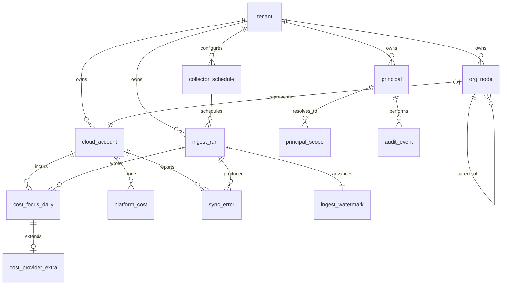

# Data model

Last updated: 2026-08-23
Update trigger: any schema change, in the same commit as the migration
Migrations: Alembic. See "Migration workflow" below
Canonical cost schema: FOCUS 1.4, ADR-0002 and ADR-0034

This document is the schema of record. A table that is not here does not exist,
and a column added without updating this document is an incomplete change.

## Principles

Six rules that shape every table below. They are not style preferences, each
one closes a specific failure this project has already reasoned about.

1. **Every table carries `tenant_id`**, including in a single tenant
   deployment. Adding it later means rewriting every query and every index. It
   is the cheapest insurance in the project.
2. **Every fact carries `as_of` and `collected_at`**, both `NOT NULL`. `as_of`
   is when the data was true at the source, `collected_at` is when Meter
   fetched it. Conflating them makes a stale number look fresh. ADR-0012.
3. **Invariants are constraints, not conventions.** If application code is the
   only thing preventing a bad row, the bad row will eventually exist. The
   idempotency key is unique in the database, not just in a Python function,
   because that is what holds when two workers race.
4. **Nothing cascades a delete onto history.** An account leaving the
   organization must not silently delete its cost records.
5. **Money is `NUMERIC(20, 10)`.** Never a float. FOCUS specifies decimal, and
   a float error compounds across a hundred million line items.
6. **Personal data is minimised, classified and retained by policy.** Every
   table is classified in `docs/09-DATA-CLASSIFICATION.md`, with a retention
   period and a scheduled job that enforces it. A column holding data about a
   person that no feature reads is not added.
7. **Timestamps are `TIMESTAMPTZ`, always UTC.** A billing period boundary in
   local time is a whole class of off by one day defects.

## Naming conventions

| Thing | Convention | Example |
| --- | --- | --- |
| Table | singular, snake case | `cloud_account` |
| Primary key | `<table>_id`, UUID v7 | `account_id` |
| Foreign key | `<referenced_table>_id` | `tenant_id` |
| Boolean | `is_` or `has_` prefix | `is_global` |
| Timestamp | `_at` suffix | `collected_at` |
| Enum column | singular noun, closed set enforced by a check constraint | `node_type` |
| Index | `ix_<table>__<columns>` | `ix_ingest_run__collector_status` |
| Unique index | `uq_<table>__<columns>` | `uq_ingest_run__idempotency_key` |
| Check constraint | `ck_<table>__<rule>` | `ck_org_node__type_valid` |
| Foreign key | `fk_<table>__<referenced>` | `fk_cloud_account__tenant` |
| Partition | `<table>_p<value>` | `cost_focus_daily_p2026_08` |

FOCUS columns keep their specification casing exactly, mapped to snake case
only where PostgreSQL requires it, and the mapping is recorded in the FOCUS
section below. ADR-0002 exists because the standard's value is that it is not
ours to improve.

## Entity relationship overview



## Tables

### Tenancy and identity

```sql
CREATE TABLE tenant (
    tenant_id       UUID PRIMARY KEY,
    name            TEXT        NOT NULL,
    created_at      TIMESTAMPTZ NOT NULL DEFAULT now(),
    CONSTRAINT uq_tenant__name UNIQUE (name)
);

CREATE TABLE principal (
    principal_id    UUID PRIMARY KEY,
    tenant_id       UUID        NOT NULL REFERENCES tenant(tenant_id),
    subject         TEXT        NOT NULL,   -- stable identifier from the identity provider
    display_name    TEXT        NOT NULL,   -- class P, anonymised after 90 days idle
    email           TEXT,                   -- class P, anonymised after 90 days idle
    tier            TEXT        NOT NULL,   -- viewer | analyst | owner
    is_global       BOOLEAN     NOT NULL DEFAULT false,
    created_at      TIMESTAMPTZ NOT NULL DEFAULT now(),
    last_seen_at    TIMESTAMPTZ,
    CONSTRAINT uq_principal__tenant_subject UNIQUE (tenant_id, subject),
    CONSTRAINT ck_principal__tier_valid
        CHECK (tier IN ('viewer', 'analyst', 'owner'))
);

-- A CACHE, never the source of truth. The source of truth is whatever
-- EntitlementResolver returns at authentication time. An entry without an
-- expiry would mean a revoked user keeps access, so expires_at is NOT NULL.
CREATE TABLE principal_scope (
    tenant_id       UUID        NOT NULL REFERENCES tenant(tenant_id),
    principal_id    UUID        NOT NULL REFERENCES principal(principal_id) ON DELETE CASCADE,
    account_id      TEXT,
    ou_id           TEXT,
    granted_via     TEXT        NOT NULL,   -- saml_role | ou_grant | global
    resolved_at     TIMESTAMPTZ NOT NULL,
    expires_at      TIMESTAMPTZ NOT NULL,
    CONSTRAINT ck_principal_scope__one_target
        CHECK (num_nonnulls(account_id, ou_id) = 1)
);
CREATE INDEX ix_principal_scope__principal_expires
    ON principal_scope (principal_id, expires_at);
```

`principal_scope` carries `tenant_id` even though `principal_id` reaches a
tenant by join. It is the authorization cache, so the repository guard must be
able to filter by tenant without a join, and a forgotten join on this table is
exactly how one tenant reads another tenant's grants.

`principal_scope` is the only table where `ON DELETE CASCADE` is correct: it is
a cache, and losing it costs one resolution.

### Accounts and organization tree

```sql
CREATE TABLE cloud_account (
    account_pk              UUID PRIMARY KEY,
    tenant_id               UUID        NOT NULL REFERENCES tenant(tenant_id),
    provider                TEXT        NOT NULL,   -- aws | gcp | azure | pcf
    account_id              TEXT        NOT NULL,   -- provider native identifier
    name                    TEXT        NOT NULL,
    -- No email column. organizations:ListAccounts returns the account root
    -- email address, which is personal data that no feature reads. Storing
    -- personal data nothing consumes is the easiest kind of exposure to avoid.
    -- See docs/09-DATA-CLASSIFICATION.md.
    status                  TEXT        NOT NULL,   -- ACTIVE | SUSPENDED | PENDING | DEPARTED | UNKNOWN
    payer_account_id        TEXT,
    joined_at               TIMESTAMPTZ,
    onboarded_at            TIMESTAMPTZ,
    collector_role_arn      TEXT,
    external_id_ref         TEXT,                   -- Secrets Manager reference, never the value
    role_health             TEXT        NOT NULL DEFAULT 'UNKNOWN',
    role_health_checked_at  TIMESTAMPTZ,
    role_health_error       TEXT,
    as_of                   TIMESTAMPTZ NOT NULL,
    collected_at            TIMESTAMPTZ NOT NULL,
    CONSTRAINT uq_cloud_account__tenant_provider_account
        UNIQUE (tenant_id, provider, account_id),
    CONSTRAINT ck_cloud_account__status_valid
        CHECK (status IN ('ACTIVE', 'SUSPENDED', 'PENDING', 'DEPARTED', 'UNKNOWN')),
    CONSTRAINT ck_cloud_account__role_health_valid
        CHECK (role_health IN ('HEALTHY', 'ACCESS_DENIED', 'NOT_DEPLOYED',
                               'THROTTLED', 'UNKNOWN'))
);
CREATE INDEX ix_cloud_account__tenant_health
    ON cloud_account (tenant_id, role_health);

CREATE TABLE org_node (
    node_pk         UUID PRIMARY KEY,
    tenant_id       UUID        NOT NULL REFERENCES tenant(tenant_id),
    node_id         TEXT        NOT NULL,
    node_type       TEXT        NOT NULL,
    parent_node_id  TEXT,
    name            TEXT        NOT NULL,
    path            TEXT        NOT NULL,   -- denormalised, rebuilt on refresh
    depth           SMALLINT    NOT NULL,
    as_of           TIMESTAMPTZ NOT NULL,
    collected_at    TIMESTAMPTZ NOT NULL,
    CONSTRAINT uq_org_node__tenant_node UNIQUE (tenant_id, node_id),
    CONSTRAINT ck_org_node__type_valid
        CHECK (node_type IN ('ROOT', 'OU', 'ACCOUNT')),
    CONSTRAINT ck_org_node__root_has_no_parent
        CHECK ((node_type = 'ROOT') = (parent_node_id IS NULL)),
    CONSTRAINT fk_org_node__parent
        FOREIGN KEY (tenant_id, parent_node_id)
        REFERENCES org_node (tenant_id, node_id)
        DEFERRABLE INITIALLY DEFERRED
);
CREATE INDEX ix_org_node__tenant_parent ON org_node (tenant_id, parent_node_id);
CREATE INDEX ix_org_node__tenant_path   ON org_node (tenant_id, path text_pattern_ops);
```

`fk_org_node__parent` is self referencing, so a node cannot name a parent that
does not exist. It is `DEFERRABLE INITIALLY DEFERRED` because the tree is
rebuilt in one transaction and children are written before their parents are
guaranteed to be present. Without the constraint, a dropped parent leaves an
orphan subtree that is simply absent from the map, and nothing reports it.

`path` and `depth` are denormalised so a subtree filter is an index scan rather
than a recursive walk. Both are rebuilt from scratch on every tree refresh, and
the refresh runs in one transaction. A reader hitting a half rebuilt tree would
see an empty organization, and an empty organization renders as zero cost.

Tree traversal:

```sql
WITH RECURSIVE subtree AS (
    SELECT node_id, parent_node_id, name, node_type, depth
      FROM org_node WHERE tenant_id = $1 AND node_id = $2
    UNION ALL
    SELECT c.node_id, c.parent_node_id, c.name, c.node_type, c.depth
      FROM org_node c
      JOIN subtree p ON c.parent_node_id = p.node_id
     WHERE c.tenant_id = $1
)
SELECT * FROM subtree;
```

### Ingestion

```sql
CREATE TABLE collector_schedule (
    tenant_id           UUID        NOT NULL REFERENCES tenant(tenant_id),
    collector           TEXT        NOT NULL,
    cadence_seconds     INTEGER     NOT NULL,
    reason              TEXT        NOT NULL,   -- why this cadence, required
    est_cost_per_run    NUMERIC(12, 6),
    is_enabled          BOOLEAN     NOT NULL DEFAULT true,
    updated_by          TEXT        NOT NULL,
    updated_at          TIMESTAMPTZ NOT NULL DEFAULT now(),
    PRIMARY KEY (tenant_id, collector),
    CONSTRAINT ck_collector_schedule__cadence_sane
        CHECK (cadence_seconds BETWEEN 60 AND 2592000)
);
```

`reason` is `NOT NULL` deliberately. A cadence without a recorded reason is a
number nobody can safely change later. ADR-0012.

```sql
CREATE TABLE ingest_run (
    run_id              UUID PRIMARY KEY,
    tenant_id           UUID        NOT NULL REFERENCES tenant(tenant_id),
    collector           TEXT        NOT NULL,
    scope_key           TEXT        NOT NULL,   -- e.g. aws:111122223333:eu-west-1
    idempotency_key     TEXT        NOT NULL,
    started_at          TIMESTAMPTZ NOT NULL DEFAULT now(),
    finished_at         TIMESTAMPTZ,
    status              TEXT        NOT NULL,
    items_written       INTEGER     NOT NULL DEFAULT 0,
    bytes_read          BIGINT      NOT NULL DEFAULT 0,
    error_type          TEXT,
    error_detail        TEXT,
    as_of_window_start  TIMESTAMPTZ NOT NULL,
    as_of_window_end    TIMESTAMPTZ NOT NULL,
    CONSTRAINT uq_ingest_run__idempotency_key UNIQUE (tenant_id, idempotency_key),
    CONSTRAINT ck_ingest_run__status_valid
        CHECK (status IN ('CLAIMED', 'RUNNING', 'SUCCEEDED', 'FAILED', 'PARTIAL')),
    CONSTRAINT ck_ingest_run__error_type_valid
        CHECK (error_type IS NULL OR error_type IN
              ('AccessDenied','Throttled','NotOptedIn','NoData','Unreachable','SchemaDrift')),
    CONSTRAINT ck_ingest_run__window_ordered
        CHECK (as_of_window_end >= as_of_window_start)
);
CREATE INDEX ix_ingest_run__tenant_collector_started
    ON ingest_run (tenant_id, collector, started_at DESC);
CREATE INDEX ix_ingest_run__stale_claims
    ON ingest_run (status, started_at) WHERE status IN ('CLAIMED', 'RUNNING');
```

`status` is a closed set of five, defined in P0 spec section 6.1. `PARTIAL`
means the run completed and wrote rows while at least one scope inside it
produced a typed error. It is the normal outcome at 300 accounts, it is not an
error state, and it must never render as success. The watermark advances only
for the scopes that succeeded.

Two constraints here carry most of the design.

`uq_ingest_run__idempotency_key` is what makes re running a collector safe. The
key is `sha256(collector, scope_key, as_of_window_start, as_of_window_end)`. It
is enforced in the database rather than in application code because that is
what holds when two workers claim the same unit simultaneously. ISS-008.

The constraint is on `(tenant_id, idempotency_key)` rather than on the key
alone. The key does not include the tenant, so a global constraint would make
two tenants who have onboarded the same account collide: the second would find
the unit already claimed, never collect it, and report nothing wrong. Every
other invariant in this schema is per tenant and this one is no different.

`ck_ingest_run__error_type_valid` mirrors the closed error taxonomy exactly. A
new error type cannot be introduced without a migration, which is deliberate:
the taxonomy staying closed is what stops every future failure becoming
generic. ISS-015.

```sql
CREATE TABLE ingest_watermark (
    tenant_id       UUID        NOT NULL REFERENCES tenant(tenant_id),
    collector       TEXT        NOT NULL,
    scope_key       TEXT        NOT NULL,
    as_of           TIMESTAMPTZ NOT NULL,
    updated_at      TIMESTAMPTZ NOT NULL DEFAULT now(),
    PRIMARY KEY (tenant_id, collector, scope_key)
);

CREATE TABLE sync_error (
    error_id        UUID PRIMARY KEY,
    tenant_id       UUID        NOT NULL REFERENCES tenant(tenant_id),
    collector       TEXT        NOT NULL,
    scope_key       TEXT        NOT NULL,
    error_type      TEXT        NOT NULL,
    detail          TEXT        NOT NULL,
    remediation     TEXT        NOT NULL,   -- what a user should do, required
    first_seen_at   TIMESTAMPTZ NOT NULL DEFAULT now(),
    last_seen_at    TIMESTAMPTZ NOT NULL DEFAULT now(),
    occurrences     INTEGER     NOT NULL DEFAULT 1,
    CONSTRAINT uq_sync_error__scope UNIQUE (tenant_id, collector, scope_key, error_type),
    CONSTRAINT ck_sync_error__type_valid
        CHECK (error_type IN
              ('AccessDenied','Throttled','NotOptedIn','NoData','Unreachable','SchemaDrift'))
);
```

`remediation` is `NOT NULL`. An error a user cannot act on without reading logs
is an error that stays unfixed.

### Cost, FOCUS 1.4

```sql
CREATE TABLE cost_focus_daily (
    -- Meter columns, alongside the FOCUS namespace, never inside it
    tenant_id                   UUID           NOT NULL,
    ingest_run_id               UUID           NOT NULL,
    source_fingerprint          TEXT           NOT NULL,
    as_of                       TIMESTAMPTZ    NOT NULL,
    collected_at                TIMESTAMPTZ    NOT NULL,
    -- Which collector wrote the row, P13 and migration 0047. Each restates only its own.
    ingest_source               TEXT           NOT NULL DEFAULT 'aws_export'
        CHECK (ingest_source IN ('aws_export', 'openai', 'anthropic')),

    -- Split cost allocation, FEAT-035. Meter columns and not FOCUS ones: FOCUS 1.1
    -- has no column for a pod, so these are the vendor extension that carries one.
    -- Every one nullable, because a charge that is not a pod's carries none of them,
    -- which is most rows. The measures are a breakdown of money already counted in
    -- billed_cost and are never added to it.
    eks_cluster_name            TEXT,
    eks_namespace               TEXT,
    eks_workload_name           TEXT,
    eks_workload_type           TEXT,
    eks_pod_name                TEXT,
    split_cost                  NUMERIC(20, 10),
    split_usage                 NUMERIC(30, 10),
    split_usage_ratio           NUMERIC(20, 10),
    unused_cost                 NUMERIC(20, 10),

    -- FOCUS 1.1
    billing_account_id          TEXT           NOT NULL,
    sub_account_id              TEXT,
    billing_period_start        DATE           NOT NULL,
    billing_period_end          DATE           NOT NULL,
    charge_period_start         TIMESTAMPTZ    NOT NULL,
    charge_period_end           TIMESTAMPTZ    NOT NULL,
    provider_name               TEXT           NOT NULL,
    publisher_name              TEXT,
    invoice_issuer_name         TEXT,
    service_name                TEXT           NOT NULL,
    service_category            TEXT,
    resource_id                 TEXT,
    resource_name               TEXT,
    region_id                   TEXT,
    availability_zone           TEXT,
    charge_category             TEXT           NOT NULL,
    charge_description          TEXT,
    sku_id                      TEXT,
    pricing_quantity            NUMERIC(30, 10),
    consumed_quantity           NUMERIC(30, 10),
    consumed_unit               TEXT,
    billed_cost                 NUMERIC(20, 10) NOT NULL,
    effective_cost              NUMERIC(20, 10) NOT NULL,
    list_cost                   NUMERIC(20, 10),
    contracted_cost             NUMERIC(20, 10),
    commitment_discount_id      TEXT,
    commitment_discount_type    TEXT,
    commitment_discount_status  TEXT,
    tags                        JSONB          NOT NULL DEFAULT '{}'::jsonb,

    -- FOCUS 1.4, P10 and ADR-0034, migration 0030: the six mandatory columns 1.1 lacked and
    -- the two that tie a row to its invoice. Nullable, because an export older than FOCUS 1.2
    -- carries none of them. service_provider_name replaced provider_name in FOCUS 1.3 and
    -- host_provider_name equals it unless a host is exposed; both are provider_name until an
    -- export carries them. provider_name and publisher_name stay until a later release.
    billing_account_name        TEXT,
    billing_currency            TEXT           CHECK (billing_currency ~ '^[A-Z]{3}$'),
    charge_class                TEXT,
    pricing_unit                TEXT,
    service_provider_name       TEXT,
    host_provider_name          TEXT,
    invoice_id                  TEXT,
    invoice_detail_id           TEXT,

    -- What a line of AI spend bought, P13 and migration 0047, FEAT-081. FOCUS reserves x_ for
    -- a producer's own columns; these stand in for the token fields FOCUS 1.5 is expected to
    -- name, OPEN-34, and are renamed by add, backfill and drop when it does. Null on every row
    -- that is not AI, which is nearly all of them.
    x_usage_type                TEXT,
    x_iam_principal             TEXT,
    x_ai_model                  TEXT,
    x_ai_token_type             TEXT
        CHECK (x_ai_token_type IN ('input', 'output', 'cache_read', 'cache_write')),
    x_ai_tokens                 NUMERIC(30, 10) CHECK (x_ai_tokens >= 0),
    CONSTRAINT ck_cost_focus_daily__tokens_have_a_type
        CHECK (x_ai_tokens IS NULL OR x_ai_token_type IS NOT NULL),
    CONSTRAINT ck_cost_focus_daily__token_type_has_a_model
        CHECK (x_ai_token_type IS NULL OR x_ai_model IS NOT NULL),

    PRIMARY KEY (tenant_id, billing_period_start, source_fingerprint)
) PARTITION BY RANGE (billing_period_start);

CREATE INDEX ix_cost_focus_daily__account_period
    ON cost_focus_daily (tenant_id, sub_account_id, billing_period_start);
CREATE INDEX ix_cost_focus_daily__service_period
    ON cost_focus_daily (tenant_id, service_name, billing_period_start);
CREATE INDEX ix_cost_focus_daily__resource
    ON cost_focus_daily (tenant_id, resource_id) WHERE resource_id IS NOT NULL;
CREATE INDEX ix_cost_focus_daily__tags
    ON cost_focus_daily USING GIN (tags jsonb_path_ops);

CREATE TABLE cost_provider_extra (
    tenant_id           UUID  NOT NULL,
    billing_period_start DATE NOT NULL,
    source_fingerprint  TEXT  NOT NULL,
    provider_fields     JSONB NOT NULL,
    PRIMARY KEY (tenant_id, billing_period_start, source_fingerprint)
) PARTITION BY RANGE (billing_period_start);
```

`source_fingerprint` is a stable hash of the identifying line item fields. It is
what makes the restatement upsert work: CUR is rewritten throughout the month,
so ingest is `INSERT ... ON CONFLICT DO UPDATE` keyed on the primary key, and
re reading a period never double counts. ISS-008.

`ingest_source` exists because the restatement delete is the one destructive
thing ingest does, and it removes every row of a period its run did not write.
From P13 the OpenAI and Anthropic collectors write to this table too, so each
collector's delete keys on its own source, and the bill's run never removes a
provider's rows. Every row before P13 is the bill's, which the default says.

The `x_` columns are filled for Bedrock from the usage type, which encodes the
model and token type, by `finops_providers/aws/bedrock_usage.py`, and given directly by the
OpenAI and Anthropic cost reports. A usage type the parser does not recognise
leaves them null: the cost counts, as Bedrock with no model, never as a guess.

`effective_cost` is the amortized measure and is the default everywhere in the
product. `billed_cost` is retained for invoice reconciliation only and is never
the default on a chart, because with commitments in play unblended per resource
cost is fiction. ISS-007.

Partitions are created one month ahead by a scheduled job. A missing partition
must raise, never silently route to a default partition, because a default
partition turns a scheduling bug into silently misfiled cost.

### Cost intelligence, the P1 second cut

Three tables added 2026-09-20 by migrations 0008 and 0009. Each carries one
decision that the schema enforces rather than the application.

```sql
CREATE TABLE cost_anomaly (
    anomaly_id      UUID PRIMARY KEY,
    tenant_id       UUID            NOT NULL REFERENCES tenant (tenant_id),
    sub_account_id  TEXT            NOT NULL,
    service_name    TEXT            NOT NULL,
    day             DATE            NOT NULL,
    observed        NUMERIC(20, 10) NOT NULL,
    baseline        NUMERIC(20, 10) NOT NULL,
    delta           NUMERIC(20, 10) NOT NULL,
    deviations      NUMERIC(12, 4),          -- null when the baseline was flat
    severity        TEXT            NOT NULL,
    why             TEXT            NOT NULL,
    as_of           TIMESTAMPTZ     NOT NULL,
    collected_at    TIMESTAMPTZ     NOT NULL
);
```

`deviations` is nullable and the null is meaningful. A perfectly flat baseline
makes every departure infinitely many deviations, which is arithmetically true
and useless, so the column says nothing rather than something false.

`ck_cost_anomaly__delta_is_the_difference` requires `delta = observed - baseline`.
A row whose three numbers disagree is one somebody will try to reconcile, and
application code is not what should be preventing it.

There is no `provenance` column. An anomaly is derived from measured line items by
arithmetic that is entirely ours, so it is neither measured nor modelled in the
sense the rest of the schema uses, and the column would force a wrong answer.
`why` carries the working instead.

```sql
CREATE TABLE commitment_use (
    use_id          UUID PRIMARY KEY,
    tenant_id       UUID            NOT NULL REFERENCES tenant (tenant_id),
    ingest_run_id   UUID            NOT NULL,
    commitment_id   TEXT            NOT NULL,
    commitment_type TEXT            NOT NULL,
    status          TEXT            NOT NULL,   -- QUEUED, ACTIVE, EXPIRED
    term_start      DATE            NOT NULL,
    term_end        DATE            NOT NULL,
    window_start    DATE            NOT NULL,
    window_end      DATE            NOT NULL,
    committed       NUMERIC(20, 10) NOT NULL,
    used            NUMERIC(20, 10) NOT NULL,
    wasted          NUMERIC(20, 10) NOT NULL,
    as_of           TIMESTAMPTZ     NOT NULL,
    collected_at    TIMESTAMPTZ     NOT NULL
);

CREATE TABLE commitment_coverage (
    coverage_id     UUID PRIMARY KEY,
    tenant_id       UUID            NOT NULL REFERENCES tenant (tenant_id),
    ingest_run_id   UUID            NOT NULL,
    commitment_type TEXT            NOT NULL,
    dimension       TEXT            NOT NULL,   -- SERVICE or REGION
    dimension_value TEXT            NOT NULL,
    window_start    DATE            NOT NULL,
    window_end      DATE            NOT NULL,
    eligible_spend  NUMERIC(20, 10) NOT NULL,
    covered_spend   NUMERIC(20, 10) NOT NULL,
    as_of           TIMESTAMPTZ     NOT NULL,
    collected_at    TIMESTAMPTZ     NOT NULL
);
```

The same commitments a day at a time, since TASK-P8-013:

```sql
CREATE TABLE commitment_day (
    day_id          UUID PRIMARY KEY,
    tenant_id       UUID            NOT NULL REFERENCES tenant (tenant_id),
    ingest_run_id   UUID            NOT NULL,
    commitment_type TEXT            NOT NULL,
    day             DATE            NOT NULL,
    committed       NUMERIC(20, 10) NOT NULL,   -- used <= committed
    used            NUMERIC(20, 10) NOT NULL,
    eligible_spend  NUMERIC(20, 10) NOT NULL,   -- covered_spend <= eligible_spend
    covered_spend   NUMERIC(20, 10) NOT NULL,
    as_of           TIMESTAMPTZ     NOT NULL,   -- the end of the day, collected_at >= as_of
    collected_at    TIMESTAMPTZ     NOT NULL,
    UNIQUE (tenant_id, commitment_type, day)
);
```

One row per kind of commitment per day, never per plan, because the provider's daily grain
reports Savings Plans use only as one total across every plan. Coverage shares the row
because at this grain neither figure is attributed to a plan, so the rule below, which is
about attributing coverage to one commitment, is not broken. `PayerWide` like the other two.

**Two tables and not one, and `commitment_coverage` deliberately has no
`commitment_id`.** A provider reports utilization per commitment and coverage per
service or region, because a dollar of covered spend cannot be attributed to one
of several overlapping plans. A `covered_spend` column on `commitment_use` would
carry a number nobody measured, and summing such a column across commitments would
count the same eligible dollar once per plan.

`wasted` is stored and constrained to `committed - used` rather than computed on
read, so a screen, a file and a report cannot disagree about it.

Both tables are `PayerWide` in `finops_api/guards.py`, a guard shape added for
them. A commitment is bought by the payer and consumed by whichever accounts ran
the usage, and no API reports which, so there is no honest way to narrow the row.
A scope that is not global reads nothing rather than reading everything, which is
the opposite of what the `None` rule would have done.

### Self metering and audit

```sql
CREATE TABLE platform_cost (
    tenant_id       UUID           NOT NULL REFERENCES tenant(tenant_id),
    day             DATE           NOT NULL,
    module          TEXT           NOT NULL,   -- 'unallocated' when untagged
    service         TEXT           NOT NULL,
    amortized_cost  NUMERIC(20, 10) NOT NULL,
    as_of           TIMESTAMPTZ    NOT NULL,
    collected_at    TIMESTAMPTZ    NOT NULL,
    PRIMARY KEY (tenant_id, day, module, service)
);

CREATE TABLE audit_event (
    event_id        UUID PRIMARY KEY,
    tenant_id       UUID        NOT NULL REFERENCES tenant(tenant_id),
    principal_id    UUID        REFERENCES principal(principal_id),
    action          TEXT        NOT NULL,
    resource        TEXT        NOT NULL,
    scope_evaluated JSONB       NOT NULL,
    is_global_read  BOOLEAN     NOT NULL DEFAULT false,
    outcome         TEXT        NOT NULL,   -- ALLOWED | DENIED
    occurred_at     TIMESTAMPTZ NOT NULL DEFAULT now(),
    request_id      TEXT        NOT NULL,
    CONSTRAINT ck_audit_event__outcome_valid CHECK (outcome IN ('ALLOWED', 'DENIED'))
);
CREATE INDEX ix_audit_event__tenant_occurred ON audit_event (tenant_id, occurred_at DESC);
CREATE INDEX ix_audit_event__global_reads
    ON audit_event (tenant_id, occurred_at DESC) WHERE is_global_read;
```

The partial index on `is_global_read` exists so that reporting on the global
viewer credential is cheap. If auditing that credential is expensive, it will
not be audited.

`platform_cost.module` uses the literal value `unallocated` for untagged cost
rather than null, because a null is easy to filter out accidentally and a self
metering report that quietly under counts is worse than none.

### Quotas and limits, P5

Three tables added 2026-09-28 by migration 0020. The interesting one is a single
check constraint.

```sql
CREATE TABLE quota_usage (
    quota_pk            UUID PRIMARY KEY,
    tenant_id           UUID            NOT NULL REFERENCES tenant (tenant_id),
    ingest_run_id       UUID            NOT NULL,
    sub_account_id      TEXT            NOT NULL,
    region_id           TEXT,                    -- null when the quota is global
    service_code        TEXT            NOT NULL,
    quota_code          TEXT            NOT NULL,
    quota_name          TEXT            NOT NULL,
    limit_value         NUMERIC(20, 10),         -- null when none is published
    used_value          NUMERIC(20, 10),         -- null when nothing measures it
    usage_source        TEXT            NOT NULL,
    unmeasurable_reason TEXT,                    -- required when, and only when,
                                                 -- usage_source is NONE
    is_adjustable       BOOLEAN         NOT NULL,
    as_of               TIMESTAMPTZ     NOT NULL,
    collected_at        TIMESTAMPTZ     NOT NULL
);
CREATE UNIQUE INDEX uq_quota_usage__identity
    ON quota_usage (tenant_id, sub_account_id, region_id, service_code, quota_code)
    NULLS NOT DISTINCT;
```

`ck_quota_usage__source_iff_usage` requires `(used_value IS NULL) = (usage_source
= 'NONE')`. It is the whole of P5 in one expression. A usage figure with no named
source cannot be audited a year later and renders identically to one that was
measured, and a named source with no figure claims a measurement nobody made and
would put the quota in the measurable list with nothing to show.

`usage_source` is one of `AWS_USAGE_METRIC`, `TRUSTED_ADVISOR`, `SERVICE_API` or
`NONE`. `NONE` is the common case rather than the error path: AWS publishes usage
for a minority of its quotas, so most rows in a real estate have a limit and no
usage, and a product rendering that as zero percent used is telling somebody they
have headroom nobody has measured. That is why the screen shows two lists.

`limit_value` is a second and different absence. A few quotas publish no limit at
all, and the adapter has to write a row for every quota Service Quotas returns,
so the alternatives would be dropping those rows or inventing a zero. Zero is a
real and different value meaning the thing is switched off here, which is why
`ck_quota_usage__limit_not_negative` allows it.

`NULLS NOT DISTINCT` on the identity index is load bearing. A global quota, IAM
roles per account and the like, carries no region, and under PostgreSQL's default
two nulls never conflict, so every collection would insert another copy of it and
the screen would show one account level limit once per region.

```sql
CREATE TABLE quota_request (
    request_pk         UUID PRIMARY KEY,
    tenant_id          UUID            NOT NULL REFERENCES tenant (tenant_id),
    ingest_run_id      UUID            NOT NULL,
    request_id         TEXT            NOT NULL,   -- AWS's own
    sub_account_id     TEXT            NOT NULL,
    region_id          TEXT,
    service_code       TEXT            NOT NULL,
    quota_code         TEXT            NOT NULL,
    desired_value      NUMERIC(20, 10) NOT NULL,
    status             TEXT            NOT NULL,   -- PENDING, CASE_OPENED,
                                                   -- APPROVED, DENIED, CASE_CLOSED
    requested_at       TIMESTAMPTZ     NOT NULL,
    last_updated_at    TIMESTAMPTZ     NOT NULL,
    submitted_by_meter BOOLEAN         NOT NULL DEFAULT FALSE,
    as_of              TIMESTAMPTZ     NOT NULL,
    collected_at       TIMESTAMPTZ     NOT NULL
);

CREATE TABLE quota_request_history (
    history_pk UUID PRIMARY KEY,
    tenant_id  UUID        NOT NULL REFERENCES tenant (tenant_id),
    request_id TEXT        NOT NULL,
    status     TEXT        NOT NULL,
    changed_at TIMESTAMPTZ NOT NULL
);
```

`submitted_by_meter` is a column that can only ever be false, enforced by
`ck_quota_request__meter_never_submits`. It is constraint 6 and P5 spec section 6
written into the schema rather than into a comment: `RequestServiceQuotaIncrease`
is a write into a member account, Meter drafts the request and hands it to a
person, and reversing that takes a migration somebody has to write and defend.

`quota_request_history` exists because the current status cannot say when a
request was approved, and FEAT-034 is about the increase nobody checked on. It
carries no `as_of`: `changed_at` is AWS's timestamp for the transition, and the
request row beside it holds the pair of timestamps for the read that found it.

### Insight and the assistant, P7

Three tables added 2026-10-04 by migrations 0023, 0024 and 0025. This section
was owed with those migrations under the routing rule and arrived in the
documentation commit after them.

```sql
CREATE TABLE assistant_exchange (
    exchange_id     UUID            PRIMARY KEY,
    tenant_id       UUID            NOT NULL REFERENCES tenant (tenant_id),
    principal_id    TEXT            NOT NULL,   -- who asked, ADR-0029
    question        TEXT            NOT NULL,   -- as screened, a secret already
                                                -- replaced by the rule that found it
    outcome         TEXT            NOT NULL,   -- ANSWERED, REFUSED or FAILED
    answer          TEXT,                       -- placeholders, never a numeral
    refusal_gap     TEXT,
    refusal_reason  TEXT,
    refusal_screen  TEXT,
    failure_cause   TEXT,                       -- one of the seven causes
    failure_detail  TEXT,
    citations       JSONB           NOT NULL,   -- an array, empty unless answered
    tool_calls      JSONB           NOT NULL,   -- an array
    model_id        TEXT,                       -- null when no model was reached
    input_tokens    INTEGER         NOT NULL,
    output_tokens   INTEGER         NOT NULL,
    est_cost        NUMERIC(20, 10) NOT NULL,   -- modelled, from configured prices
    asked_at        TIMESTAMPTZ     NOT NULL,
    answered_at     TIMESTAMPTZ     NOT NULL
);

CREATE TABLE team_digest (
    digest_id       UUID         PRIMARY KEY,
    tenant_id       UUID         NOT NULL REFERENCES tenant (tenant_id),
    ingest_run_id   UUID         NOT NULL,
    audience        TEXT         NOT NULL,      -- team or executive
    team            TEXT,                       -- required when, and only when,
                                                -- the audience is a team
    period_start    DATE         NOT NULL,
    period_end      DATE         NOT NULL,
    prose           TEXT         NOT NULL,
    citations       JSONB        NOT NULL,
    composed_at     TIMESTAMPTZ  NOT NULL,
    sent_at         TIMESTAMPTZ,                -- null until a sender exists, OPEN-11
    unsent_reason   TEXT                        -- required when, and only when,
                                                -- sent_at is null
);
CREATE UNIQUE INDEX uq_team_digest__identity
    ON team_digest (tenant_id, audience, coalesce(team, ''), period_start);

CREATE TABLE redaction_event (
    event_id        UUID         PRIMARY KEY,
    tenant_id       UUID         NOT NULL REFERENCES tenant (tenant_id),
    exchange_id     UUID         NOT NULL REFERENCES assistant_exchange (exchange_id),
    principal_id    TEXT         NOT NULL,
    rule_id         TEXT         NOT NULL,      -- the gitleaks rule identifier
    action          TEXT         NOT NULL,      -- BLOCKED or REDACTED
    occurred_at     TIMESTAMPTZ  NOT NULL,
    found_in        TEXT         NOT NULL DEFAULT 'question'  -- or tool_result, 0046, ISS-085
);
```

`assistant_exchange` holds three outcomes in one row, and twelve check
constraints keep them apart. An answer exists when, and only when, the outcome
is ANSWERED, a gap and a reason of at least twelve characters when, and only
when, it is REFUSED, and a cause from the seven when, and only when, it is
FAILED. A citation is only ever attached to an answer. `GET
/assistant/exchanges` returns all three outcomes as one list, and the response
model refuses a row that carries a shape its outcome does not name.

`ck_assistant_exchange__spend_needs_a_model` requires a model identifier on any
row with tokens or cost. A question refused before it reached a model, by the
budget or by redaction, records zero spend and no model, and that zero is true.
A row claiming spend against no model would be a cost nobody can attribute.

`team_digest` stores a digest whether or not anything can send it. `sent_at`
null is a real state with a required reason, the shape FEAT-060 used for a
budget with no collected period, and the screen says composed and not sent
rather than hiding the row. The identity index uses `coalesce(team, '')`
because the executive digest has no team, and under PostgreSQL's default two
executive digests for one week would not collide.

`redaction_event` has no column the secret could go in: not the matched text,
not a hash, not its position and not its length. A table of redacted secrets is
a worse leak than the prompt would have been. Its foreign key to the exchange
has no cascade, so the question cannot be deleted from under the record of what
was found in it.

Two of the three tables hold a person's identifier, and the guard confines them
to that person through the `ByPrincipal` rule, ADR-0029. `retention_assistant`
removes a question older than 90 days with its redaction records, OPEN-14, and
`erase_principal` tombstones a person's questions and hashes their identifier,
ISS-226. `team_digest` holds no personal data and has no retention job yet.

### Export records, P8

Migration `0026_report_run`, FEAT-067. One row for every file an export writes, inserted by
`finops_api/db/repositories/reports.py` in the transaction of the read it records, so a file
cannot leave without its record.

```sql
CREATE TABLE report_run (
    run_id          UUID         PRIMARY KEY,
    tenant_id       UUID         NOT NULL REFERENCES tenant (tenant_id),
    principal_id    TEXT         NOT NULL,      -- who made the file
    view_path       TEXT         NOT NULL,      -- the route, /api/v1/...
    view_query      TEXT         NOT NULL,      -- its query, without the format
    scope_global    BOOLEAN      NOT NULL,
    scope_accounts  TEXT[]       NOT NULL,      -- the accounts a narrowed scope named,
                                                -- empty for a global one
    format          TEXT         NOT NULL,      -- xlsx or csv
    row_count       INTEGER      NOT NULL,
    byte_count      BIGINT       NOT NULL,
    truncated       BOOLEAN      NOT NULL,      -- a workbook stopped at the row limit
    made_at         TIMESTAMPTZ  NOT NULL
);
CREATE INDEX ix_report_run__principal ON report_run (tenant_id, principal_id, made_at);
```

Four check constraints hold it: the format is one of two, the counts are never negative, the
person is named and the view is a path, and a global scope names no accounts. The accounts are
a list rather than a count, because a count says how much was taken and the list says what,
which is the question an audit asks. The guard confines the table to its person through
`ByPrincipal`, ADR-0029, so a reader lists their own runs and nobody else's, which the
Scheduled screen does, FEAT-069. No retention job reads it; `erase_principal` hashes the
identifier and keeps the row, ISS-249.

### Saved views, P8

Migration `0028_saved_view`, FEAT-068. A screen and its query under a name, kept by the person
who saved it or shared with the tenant. Configuration and never data: no column holds a figure,
so opening a view reads its screen afresh in the opener's scope.

```sql
CREATE TABLE saved_view (
    view_id      UUID         PRIMARY KEY,
    tenant_id    UUID         NOT NULL REFERENCES tenant (tenant_id),
    owner_id     TEXT         NOT NULL,      -- who saved it
    name         TEXT         NOT NULL,
    screen_path  TEXT         NOT NULL,      -- a screen the navigation knows
    query        JSONB        NOT NULL,      -- its query string as an object
    visibility   TEXT         NOT NULL,      -- PRIVATE or SHARED
    created_at   TIMESTAMPTZ  NOT NULL,
    updated_at   TIMESTAMPTZ  NOT NULL
);
CREATE INDEX ix_saved_view__owner ON saved_view (tenant_id, owner_id, updated_at);
CREATE INDEX ix_saved_view__shared ON saved_view (tenant_id, updated_at)
    WHERE visibility = 'SHARED';
```

Five check constraints hold it: the visibility is one of two, the owner and the name are not
blank and the name is not over its length, the screen is one of the paths in
`finops_api/screens.py` on the day the migration ran, the query is a JSON object, and a view is
never changed before it was made. A screen added to the navigation widens the screen constraint
in a migration of its own, and `tests/api/test_saved_views.py` reads the constraint back out of
the database to hold it to the list. The guard reads the table through `OwnedOrShared`,
ADR-0032: the owner reads their views, everybody in the tenant reads the shared ones, and only
the owner's writes change a row. No retention job reads it; `erase_principal` removes a person's
private views and keeps their shared ones, owned by a hash, ISS-255.

### Report schedules and what a run records, P8

Migration `0029_report_schedule`, FEAT-069 and ADR-0033.

```sql
CREATE TABLE report_schedule (
    schedule_id  UUID         PRIMARY KEY,
    tenant_id    UUID         NOT NULL REFERENCES tenant (tenant_id),
    owner_id     TEXT         NOT NULL,
    view_id      UUID         REFERENCES saved_view (view_id) ON DELETE SET NULL,
    export_path  TEXT         NOT NULL,      -- the route a run renders, /api/v1/..., no format
    format       TEXT         NOT NULL,      -- xlsx or csv
    cadence      TEXT         NOT NULL,      -- DAILY, WEEKLY, MONTHLY or MONTH_CLOSE
    recipients   TEXT[]       NOT NULL,      -- the principals it renders for
    enabled      BOOLEAN      NOT NULL,
    next_run_at  TIMESTAMPTZ  NOT NULL,
    created_at   TIMESTAMPTZ  NOT NULL,
    updated_at   TIMESTAMPTZ  NOT NULL
);
-- report_run gains the schedule that made it, its status, where its file is kept, the
-- typed cause of a failure, the freshness of what it read, and when it finished.
ALTER TABLE report_run
    ADD COLUMN schedule_id    UUID REFERENCES report_schedule (schedule_id) ON DELETE SET NULL,
    ADD COLUMN status         TEXT NOT NULL DEFAULT 'STREAMED',
    ADD COLUMN storage_key    TEXT,
    ADD COLUMN failure_cause  TEXT,
    ADD COLUMN failure_detail TEXT,
    ADD COLUMN as_of          TIMESTAMPTZ,
    ADD COLUMN collected_at   TIMESTAMPTZ,
    ADD COLUMN finished_at    TIMESTAMPTZ;
-- Which process runs each cadence: the ingest worker, or the API for the scheduled reports.
ALTER TABLE collector_schedule ADD COLUMN runs_in TEXT NOT NULL DEFAULT 'worker';
```

A schedule's checks hold the format, the cadence, between one and fifty recipients none of them
blank, a named owner, a route of this API's own with no format in it, and a schedule never
changed before it was made. A trigger holds the invariant a check cannot read: the view is one
the owner can open, their own or a shared one, in the schedule's tenant. A view deleted later
leaves its schedules with no view rather than deleting other people's schedules with it, and the
runner records why for each recipient once and pauses them. A run's checks hold four
statuses, a typed cause on a failure and on nothing else, a key on a file kept or sent, neither a
key nor a schedule on a file streamed to whoever exported it, and a finish never before the
making. The guard reads `report_schedule` through `ByPrincipal` on its owner. No retention job
reads it; `erase_principal` pauses a person's schedules and takes them off every recipient
list, ISS-256.

### Billing periods and invoices, P10

FEAT-076, migration 0031. FOCUS 1.4's Billing Period and Invoice Detail datasets at the grain
AWS gives, one row per whole invoice. Stored as read: Meter's own sum over the cost rows and
the difference are computed when read, TASK-P10-004. Both are payer wide, ADR-0025.

```sql
CREATE TABLE billing_period (
    billing_period_pk     UUID PRIMARY KEY,
    tenant_id             UUID NOT NULL REFERENCES tenant(tenant_id),
    ingest_run_id         UUID NOT NULL,
    billing_period_start  DATE NOT NULL,
    billing_period_end    DATE NOT NULL,
    billing_period_status TEXT NOT NULL,       -- 'Open' or 'Closed', FOCUS 1.4's words
    as_of                 TIMESTAMPTZ NOT NULL, -- first invoice issued, or now while open
    collected_at          TIMESTAMPTZ NOT NULL,
    UNIQUE (tenant_id, billing_period_start),
    CHECK (billing_period_end > billing_period_start),
    CHECK (collected_at >= as_of)
);

CREATE TABLE invoice_detail (
    invoice_detail_pk      UUID PRIMARY KEY,
    tenant_id              UUID NOT NULL REFERENCES tenant(tenant_id),
    ingest_run_id          UUID NOT NULL,
    invoice_id             TEXT NOT NULL,
    invoice_detail_id      TEXT NOT NULL,      -- the invoice_id, at AWS's grain
    invoice_type           TEXT NOT NULL,      -- 'INVOICE' or 'CREDIT_MEMO'
    original_invoice_id    TEXT,               -- required on a credit memo
    billing_account_id     TEXT NOT NULL,
    billing_period_start   DATE NOT NULL,
    billing_period_end     DATE NOT NULL,
    invoice_issuer_name    TEXT NOT NULL,      -- not always AWS: Marketplace
    billing_currency       TEXT NOT NULL,      -- ISO 4217, '^[A-Z]{3}$'
    billed_cost_before_tax NUMERIC(20,10) NOT NULL,
    tax                    NUMERIC(20,10) NOT NULL,
    billed_cost            NUMERIC(20,10) NOT NULL,
    issued_at              TIMESTAMPTZ NOT NULL,
    due_date               DATE,
    as_of                  TIMESTAMPTZ NOT NULL, -- the issue time
    collected_at           TIMESTAMPTZ NOT NULL,
    UNIQUE (tenant_id, invoice_id)
);
```

The amounts are not constrained to add up: AWS documents the total and the amount before
tax but not the arithmetic between them once fees and discounts are in the breakdown, and a
constraint could refuse a real invoice.

### The price catalog, P9

Migration 0033, TASK-P9-003. AWS's own prices and descriptions, per tenant as every table is,
under the guard's tenant rule and nothing narrower, because they are public and about no account.
Every invariant is a constraint and `tests/db/test_price_catalog_constraints.py` writes a row
breaking each.

```sql
CREATE TABLE price_list_version (          -- one publication, one service, one Region
    service_code, region, version TEXT NOT NULL, row_count INTEGER NOT NULL >= 0,
    as_of TIMESTAMPTZ,                     -- the publication date
    collected_at TIMESTAMPTZ >= as_of,
    UNIQUE (tenant_id, service_code, region, version)
);

CREATE TABLE price (                       -- one offer term, spec 5.3 as corrected 2026-10-08
    service_code, region, sku, sku_price_id, sku_meter, pricing_unit TEXT NOT NULL,
    pricing_category TEXT IN ('Standard', 'Committed'),
    currency TEXT ~ '^[A-Z]{3}$',
    recurring_unit_price, upfront_fee NUMERIC(20,10) >= 0, not both nought,
    lease_years SMALLINT IN (1, 3), purchase_option, offering_class,
                                           -- present together exactly on a reservation
    sku_price_details JSONB object, effective_date DATE, version TEXT,
    as_of, collected_at >= as_of,
    UNIQUE (tenant_id, region, sku_price_id, version),
    FOREIGN KEY (tenant_id, service_code, region, version) REFERENCES price_list_version
);

CREATE TABLE instance_type_spec (          -- EC2 and the four managed services
    service_code, region, instance_type, family TEXT, current_generation BOOLEAN,
    architectures TEXT[] not empty, burstable BOOLEAN,
    baseline_cpu NUMERIC in (0, 1], maximum_credits, baseline_source,
                                           -- required of a burstable type
    vcpus INTEGER > 0, memory_mib BIGINT > 0, network_performance TEXT,
    network_baseline_gbps <= network_peak_gbps, ebs_baseline_mbps <= ebs_maximum_mbps,
    gpu_count >= 0, offered BOOLEAN,
    UNIQUE (tenant_id, service_code, region, instance_type)
);

CREATE TABLE volume_type_spec (            -- included and maximum performance, sourced
    volume_type TEXT, baseline_iops <= maximum_iops > 0,
    baseline_throughput_mibps <= maximum_throughput_mibps > 0, iops_per_gib,
    source TEXT not blank, UNIQUE (tenant_id, volume_type)
);

CREATE TABLE spot_price (                  -- the latest per pool, replaced each run, OPEN-18
    region, availability_zone, instance_type, product_description TEXT,
    price > 0, as_of (the reading), collected_at >= as_of,
    UNIQUE (tenant_id, region, availability_zone, instance_type, product_description)
);

CREATE TABLE spot_price_daily (            -- a pool's daily low and high, kept 90 days
    the pool, day DATE, low <= high, both > 0, readings > 0,
    UNIQUE (the pool, day)
);
```

The recommendation gains four nullable columns, `current_sku_price_id`,
`target_instance_type`, `target_sku_price_id` and `price_version`: a target is named with its
price and version or not at all, and each price id is held by a composite foreign key to a price
of the same tenant, Region and version, so a saving is quoted only from two prices that exist
together. TASK-P9-006 writes them for Compute Optimizer's findings, from the first ranked
option and the instance's current type; TASK-P9-007 for Meter's own.

`volume_type_spec` is written by the instance catalog collector from TASK-P9-009: gp2 and gp3,
two rows rewritten in place each run, from the EBS user guide read on 2026-10-08 and named in
`source`, because no AWS call describes a volume type's limits. gp2's baseline depends on its size,
so its baseline columns are null and `iops_per_gib` is the rate it grows by; gp3's `iops_per_gib`
is the most that may be provisioned. The figures are the ones `finops_query/volumes.py` prices a
gp3 move from, so the table shows what the rule used.

`recommendation_option` also holds Meter's own alternatives from TASK-P9-010: every type its sizing
rule found to fit, cheapest first, the chosen one ranked first, rewritten each run. Compute
Optimizer scores its options' performance risk from 0 to 4 and Meter's rule gives none, so
migration 0040 lets `performance_risk` be null, meaning the source gave no score; the 0 to 4 check
still holds every score given. OPEN-24.

```
CREATE TABLE resource_owner (            -- P11, FEAT-077: one row per resource per source
    sub_account_id, region_id NULL for a global resource, resource_id not blank,
    source in (CATALOGUE, TAG, CREATOR), owner and detail not blank,
    owner_kind in (TEAM, PERSON, AUTOMATION), a TAG row a TEAM, a CREATOR row never one,
    collected_at >= as_of, UNIQUE (tenant_id, sub_account_id, resource_id, source)
);
```

A suggestion of whom to ask, never an owner: `recommendation.owner` stays a person's to write.
Written by the `ownership` collector, migration 0041, which replaces the tag and catalogue rows
each run, so a tag taken off a resource stops suggesting its team, and keeps a creator's row, which
cannot change. Scoped by account, `ByAccount`.

```
CREATE TABLE creator_lookup (            -- P11, FEAT-077: one row per resource ever asked about
    sub_account_id, region_id, resource_id not blank, outcome in (FOUND, BEFORE_HISTORY),
    history_starts set exactly when the outcome is BEFORE_HISTORY, collected_at >= as_of,
    UNIQUE (tenant_id, sub_account_id, resource_id)
);
```

Which resources CloudTrail's event history was asked who created them, migration 0042, so none is
asked twice: a FOUND resource has its CREATOR row in `resource_owner`, and one older than the
history keeps where the history began. Never replaced, since the answer cannot change. Scoped by
account, `ByAccount`.

```
CREATE TABLE savings_credit (            -- P11, FEAT-078: one per verified saving
    sub_account_id, recommendation_id REFERENCES recommendation,
    realized_id REFERENCES realized_saving, never cascading, UNIQUE,
    owner and closed_by not blank, team named or null, verified_monthly_saving > 0,
    verified_on DATE, collected_at >= as_of
);
```

A credit for a saving FEAT-029 verified, migration 0043: the owner, the team named for the
resource and the person who closed it, fixed when first written, and the verified monthly saving,
measured. Written by the daily `savings_ledger` collector, which withdraws a credit whose saving no
longer verifies. Scoped by account, `ByAccount`.

```
CREATE TABLE savings_credit_month (      -- P11, FEAT-078: each closed month after verification
    credit_id REFERENCES savings_credit, never cascading, month DATE the first of a month,
    state in (HELD, REGRESSED, UNOBSERVED), cost and saving null exactly when UNOBSERVED,
    saving > 0 when HELD and <= 0 when REGRESSED, cost >= 0, collected_at >= as_of,
    UNIQUE (credit_id, month)
);
```

Each closed month after a credited saving verified, migration 0044, judged against the cost before
the change at FEAT-029's daily rate. A month's `as_of` is the moment it closed. The collector
judges every month again each run and removes a month it no longer judges, after a regression or
under a withdrawn credit, before the credit. Scoped by account, `ByAccount`.

```sql
CREATE TABLE recommendation_option (       -- every target a provider ranked, migration 0038
    recommendation_id REFERENCES recommendation, region TEXT, rank >= 1, instance_type TEXT,
    performance_risk 0 to 4, provider_monthly_saving (any sign), migration_effort,
    platform_differences TEXT[],
    sku_price_id, price_version, hourly_price > 0,    -- all three, from one recorded price
    unpriced_reason,                                  -- or this instead, never both
    FOREIGN KEY (tenant_id, region, sku_price_id, price_version) REFERENCES price,
    UNIQUE (recommendation_id, rank)
);
```

An option is priced from a recorded price, with its version and hourly price beside it, or it
names why it could not be, never both and never neither, so an unpriced option is never a price
of nought. Price pruning spares a price an option quotes, as it spares one a recommendation
quotes. Scoped through its recommendation, as `recommendation_event` is. OPEN-23.

The recommendation also gains `added_monthly_cost`, migration 0039, TASK-P9-008: an
`UPSIZE_INSTANCE` row has one above nought and a saving of nought, and no other row has one, so an
Upsize states what it adds to the bill and no total of savings can fall because of it.

### AI usage per caller, P13

```sql
-- P13, FEAT-082, migration 0048. Tokens and requests per day, model and caller, from every AI
-- source: the Bedrock invocation logs now, OpenAI's and Anthropic's usage reports from
-- TASK-P13-004 and 005. An empty string in a key column means the source does not report that
-- dimension, which a NULL cannot say inside a primary key.
CREATE TABLE ai_usage_daily (
    tenant_id          UUID        NOT NULL REFERENCES tenant(tenant_id),
    ingest_run_id      UUID        NOT NULL,
    provider           TEXT        NOT NULL,   -- bedrock | openai | anthropic
    account_id         TEXT        NOT NULL,   -- a cloud account, or the provider's organization
    usage_date         DATE        NOT NULL,
    model              TEXT        NOT NULL,   -- as the source names it
    workspace          TEXT        NOT NULL DEFAULT '',  -- the Region, the project or the workspace
    api_key_id         TEXT        NOT NULL DEFAULT '',
    caller             TEXT        NOT NULL DEFAULT '',  -- class P: an IAM ARN or a user
    application        TEXT        NOT NULL DEFAULT '',  -- the request metadata key's value
    input_tokens       BIGINT      NOT NULL,
    output_tokens      BIGINT      NOT NULL,
    cache_read_tokens  BIGINT      NOT NULL,
    cache_write_tokens BIGINT      NOT NULL,
    requests           BIGINT,                 -- null where a source counts tokens only
    as_of              TIMESTAMPTZ NOT NULL,
    collected_at       TIMESTAMPTZ NOT NULL,
    CONSTRAINT pk_ai_usage_daily PRIMARY KEY (tenant_id, provider, account_id, usage_date,
        model, workspace, api_key_id, caller, application),
    CONSTRAINT ck_ai_usage_daily__provider
        CHECK (provider IN ('bedrock', 'openai', 'anthropic')),
    CONSTRAINT ck_ai_usage_daily__model_named CHECK (model <> ''),
    CONSTRAINT ck_ai_usage_daily__tokens_not_negative CHECK (
        input_tokens >= 0 AND output_tokens >= 0
        AND cache_read_tokens >= 0 AND cache_write_tokens >= 0),
    CONSTRAINT ck_ai_usage_daily__requests_not_negative CHECK (requests >= 0),
    CONSTRAINT ck_ai_usage_daily__collected_after_true CHECK (collected_at >= as_of)
);
CREATE INDEX ix_ai_usage_daily__tenant_date ON ai_usage_daily (tenant_id, usage_date);
```

Never a cost. What a caller's tokens cost is modelled when it is read, from the bill's unit cost
for the same model and day, because only the bill knows the price that was paid. A source's
rerun of a window removes that window's rows it no longer reports, keyed on the provider, the
account, the dates and, for Bedrock, the Region, and on the run id like the bill's restatement.
Kept 13 months by `retention_ai_usage`, because a caller can name a person.

### GPU utilization, P13

```sql
-- P13, FEAT-084, migration 0052. How busy each GPU instance's accelerators were in a day, from
-- the CloudWatch agent's NVIDIA metrics. The instances are the ones the bill names; hours and
-- cost come from the bill itself, cost_focus_daily, by the x_usage_type.
CREATE TABLE gpu_utilization_daily (
    tenant_id        UUID          NOT NULL REFERENCES tenant(tenant_id),
    ingest_run_id    UUID          NOT NULL,
    account_id       TEXT          NOT NULL,
    region_id        TEXT          NOT NULL,
    instance_id      TEXT          NOT NULL,
    usage_date       DATE          NOT NULL,
    gpu_count        INTEGER       NOT NULL,   -- accelerators that published
    average_percent  NUMERIC(5, 2) NOT NULL,   -- the mean of their daily averages
    peak_percent     NUMERIC(5, 2) NOT NULL,   -- the highest of their peaks
    samples          INTEGER       NOT NULL,   -- the readings they came from
    as_of            TIMESTAMPTZ   NOT NULL,
    collected_at     TIMESTAMPTZ   NOT NULL,
    CONSTRAINT pk_gpu_utilization_daily
        PRIMARY KEY (tenant_id, account_id, region_id, instance_id, usage_date),
    CONSTRAINT ck_gpu_utilization_daily__measured CHECK (gpu_count > 0 AND samples > 0),
    CONSTRAINT ck_gpu_utilization_daily__percentages CHECK (
        average_percent BETWEEN 0 AND 100 AND peak_percent BETWEEN 0 AND 100),
    CONSTRAINT ck_gpu_utilization_daily__peak_at_least_average
        CHECK (peak_percent >= average_percent),
    CONSTRAINT ck_gpu_utilization_daily__collected_after_true CHECK (collected_at >= as_of)
);
```

An instance whose agent published nothing has no row, so the screen reads it as not published,
never as nought percent; the constraints are why a row cannot say less than one reading. A rerun of
a day replaces that day's rows for its account and Region. Which usage types are accelerated is
`accelerated_instance_type` in `finops_core/domain/ai.py`: the p, g, gr, trn, inf and dl families,
SageMaker's `ml.` form among them, read from the family so a new size is recognised.

### Commitments held, P14

```sql
-- P14, FEAT-086, migration 0054. Each commitment a member account holds, read from the service
-- that sold it with that account's collector role: a Savings Plan or a reservation, with its real
-- start, end, term and payment. Payer wide, ADR-0025, as commitment use and coverage are.
CREATE TABLE commitment_inventory (
    tenant_id          UUID            NOT NULL REFERENCES tenant(tenant_id),
    ingest_run_id      UUID            NOT NULL,
    kind               TEXT            NOT NULL,   -- savings_plan or reservation
    commitment_id      TEXT            NOT NULL,   -- the source's own identifier
    program            TEXT            NOT NULL,   -- Compute, EC2Instance, EC2, RDS, ...
    account_id         TEXT            NOT NULL,   -- the account that bought it
    region_id          TEXT,                       -- None for a plan in every Region
    applies_to         TEXT,                       -- the type, class or family
    quantity           INTEGER,                    -- a reservation's count
    hourly_commitment  NUMERIC(20, 10),            -- a Savings Plan's amount an hour
    term_months        INTEGER         NOT NULL,
    payment_option     TEXT            NOT NULL,
    upfront_amount     NUMERIC(20, 10) NOT NULL,
    recurring_hourly   NUMERIC(20, 10) NOT NULL,
    currency           TEXT            NOT NULL,
    starts_at          TIMESTAMPTZ     NOT NULL,
    ends_at            TIMESTAMPTZ     NOT NULL,
    state              TEXT            NOT NULL,   -- active, retired, queued, ...
    as_of              TIMESTAMPTZ     NOT NULL,
    collected_at       TIMESTAMPTZ     NOT NULL,
    CONSTRAINT pk_commitment_inventory PRIMARY KEY (tenant_id, kind, commitment_id),
    CONSTRAINT ck_commitment_inventory__kind CHECK (kind IN ('savings_plan', 'reservation')),
    CONSTRAINT ck_commitment_inventory__one_measure CHECK (
        (quantity IS NULL) <> (hourly_commitment IS NULL)),
    CONSTRAINT ck_commitment_inventory__positive CHECK (
        term_months > 0 AND (quantity IS NULL OR quantity > 0)
        AND (hourly_commitment IS NULL OR hourly_commitment > 0)
        AND upfront_amount >= 0 AND recurring_hourly >= 0),
    CONSTRAINT ck_commitment_inventory__ends_after_start CHECK (ends_at > starts_at),
    CONSTRAINT ck_commitment_inventory__collected_after_true CHECK (collected_at >= as_of)
);
```

Exactly one of quantity and hourly commitment, because a reservation buys instances and a Savings
Plan an amount an hour, and a sum of the two would mean nothing. A retired commitment stays a row:
its usage went back on demand the day it ended, which the renewal calendar exists to see coming. A
run restates the scope it read, the account and Region's reservations and, in the first collection
Region's unit only, the account's Savings Plans; a read that fails removes nothing.

### Commitment policy, P14

```sql
-- P14, FEAT-088, migration 0055. What a tenant's purchase plans aim for, one row per tenant, the
-- cautious default installed for every one, OPEN-38. Payer wide, ADR-0025.
CREATE TABLE commitment_policy (
    tenant_id        UUID          NOT NULL REFERENCES tenant(tenant_id),
    target_coverage  NUMERIC(4, 3) NOT NULL,   -- of the steady baseline, above 0, at most 1
    term_years       INTEGER       NOT NULL,   -- 1 or 3, the terms AWS sells
    payment_option   TEXT          NOT NULL,   -- No Upfront, Partial Upfront or All Upfront
    ladder_limit     NUMERIC(5, 4) NOT NULL,   -- the most of the commitment ending in a month
    reason           TEXT          NOT NULL,   -- a policy is a decision, so it says why
    updated_by       TEXT          NOT NULL,   -- the person, or the migration or seed
    updated_at       TIMESTAMPTZ   NOT NULL DEFAULT now(),
    CONSTRAINT pk_commitment_policy PRIMARY KEY (tenant_id)
    -- and a check on each bound, so a policy no plan could follow cannot be stored
);
```

Changed through `PUT /v1/commitments/policy` by a person whose scope is the organization, with a
reason, audited ALLOWED or DENIED. An erasure keeps the policy and replaces `updated_by`, as it does
a cadence's.

### AWS's purchase recommendations, P14

```sql
-- P14, FEAT-089, migration 0056. AWS's advice for each Savings Plans type and reserved service, in
-- the tenant's policy's terms, one row each. Payer wide, ADR-0025.
CREATE TABLE purchase_recommendation (
    tenant_id                  UUID           NOT NULL REFERENCES tenant(tenant_id),
    ingest_run_id              UUID           NOT NULL,
    kind                       TEXT           NOT NULL,   -- savings_plan | reservation
    program                    TEXT           NOT NULL,   -- the plan type, or Cost Explorer's service name
    term_years                 INTEGER        NOT NULL,   -- as the policy asked
    payment_option             TEXT           NOT NULL,
    lookback_days              INTEGER        NOT NULL,
    recommended                BOOLEAN,                   -- false: AWS looked and advises nothing
    hourly_commitment          NUMERIC(20, 10),           -- a Savings Plan's, never a reservation's
    units                      NUMERIC(20, 4),            -- a reservation's, never a Savings Plan's
    estimated_monthly_savings  NUMERIC(20, 10),           -- AWS's estimate, labelled so
    estimated_savings_percent  NUMERIC(10, 4),
    upfront_cost               NUMERIC(20, 10),
    currency                   TEXT,
    failure_cause              TEXT,                      -- a typed cause, or null for an answer
    failure_detail             TEXT,
    as_of                      TIMESTAMPTZ    NOT NULL,   -- when AWS generated it
    collected_at               TIMESTAMPTZ    NOT NULL,
    CONSTRAINT pk_purchase_recommendation PRIMARY KEY (tenant_id, kind, program)
    -- and checks: an answer or a failure, never both; each measure on its own kind; collected
    -- after true
);
```

A read that failed is a row with its cause and no figures, so one service Cost Explorer refuses is
seen beside the ones that answered and never drawn as advice to buy nothing. A run restates every
row; a type or service no longer asked about leaves.

### Meter's purchase plans, P14

```sql
-- P14, FEAT-089, migration 0057. One plan per tenant per month, its lines and its lifecycle.
-- Payer wide, ADR-0025. Every figure modelled.
CREATE TABLE purchase_plan (
    plan_id             UUID           PRIMARY KEY,
    tenant_id           UUID           NOT NULL REFERENCES tenant(tenant_id),
    plan_month          DATE           NOT NULL,   -- the first of the month; unique per tenant
    status              TEXT           NOT NULL,   -- DRAFT APPROVED BOUGHT VERIFIED WITHDRAWN LAPSED
    target_coverage, term_years, payment_option, ladder_limit,   -- the policy it was drafted under
    window_start, window_end, days_held,   -- the bill it was drawn from
    steady_hourly, held_hourly, target_hourly, beyond_hourly,   -- null where too few days
    unpriced            JSONB          NOT NULL,   -- shares no rate prices, each with why
    no_purchase_reason  TEXT,
    as_of, collected_at
);
CREATE TABLE purchase_plan_line (
    plan_id, line_no,                       -- primary key
    program             TEXT  NOT NULL,     -- EC2Instance with a family and Region, or Compute
    instance_family, region_id,             -- both or neither, by program
    tranche_month       DATE  NOT NULL,     -- this month, or a later tranche
    hourly_commitment, discount_percent, covers_hourly, monthly_saving, usage_floor_percent,
    upfront_cost,
    matched_commitment_id                   -- TASK-P14-008
);
CREATE TABLE purchase_plan_event (
    event_id, plan_id, tenant_id,
    from_status, to_status,                 -- a check allows only the lifecycle's transitions
    principal           TEXT  NOT NULL,     -- a person, or collector:purchase_plan
    at, note
);
```

A trigger on `purchase_plan` refuses an insert that is not a draft and a change of status the
lifecycle does not allow, so no path can write a plan bought before it was approved, constraint 11.
The collector redrafts a draft in place, replacing its lines, and lapses a draft from an earlier
month; a plan in any other status is left as it is.

Migration 0058, TASK-P14-008, adds `uq_purchase_plan_line__matched_once`, a unique index on
`(tenant_id, matched_commitment_id)` where it is set, so one commitment never pays for two lines.
A bought plan's own month's lines are matched daily to Savings Plans in `commitment_inventory`, and
the plan is verified when every one is matched.

### AI provider organizations, P13

```sql
-- P13, FEAT-083, migration 0049. The OpenAI and Anthropic organizations a tenant connected. The
-- organization is the key, because it belongs to one tenant; the admin key is never here.
CREATE TABLE ai_provider_account (
    provider         TEXT        NOT NULL,   -- openai | anthropic
    organization_id  TEXT        NOT NULL,
    tenant_id        UUID        NOT NULL REFERENCES tenant(tenant_id),
    name             TEXT        NOT NULL,
    key_secret_name  TEXT        NOT NULL,   -- a Secrets Manager name, never a value
    enrolled_at      TIMESTAMPTZ NOT NULL,
    active           BOOLEAN     NOT NULL DEFAULT true,
    CONSTRAINT pk_ai_provider_account PRIMARY KEY (provider, organization_id),
    CONSTRAINT ck_ai_provider_account__provider CHECK (provider IN ('openai', 'anthropic')),
    CONSTRAINT ck_ai_provider_account__named
        CHECK (length(trim(organization_id)) > 0 AND length(trim(name)) > 0),
    CONSTRAINT ck_ai_provider_account__key_under_the_ai_path
        CHECK (key_secret_name ~ '^meter/[a-z]+/ai/[A-Za-z0-9/_+=.@-]+$')
);
CREATE INDEX ix_ai_provider_account__tenant ON ai_provider_account (tenant_id, provider);
```

Written by `scripts/ops/connect_ai_provider.py` only once the key has read a day of costs, and
read by each provider's collector on every run, so `active` false stops the reads and keeps what
was read. The constraint on the secret's name is what stops a row pointing the worker at a secret
outside the AI path, whatever the role would allow. A provider's cost lands in `cost_focus_daily`
with its own `ingest_source`, the organization as the billing account and the project or workspace
as the sub account, and its usage in `ai_usage_daily`.

### Where fixes go, P15

```sql
-- P15, FEAT-091, migration 0059. The GitHub App a tenant connected, one row per tenant, OPEN-13.
-- Payer wide, ADR-0025.
CREATE TABLE code_host_connection (
    tenant_id        UUID        NOT NULL REFERENCES tenant(tenant_id),
    host             TEXT        NOT NULL,   -- github, the one host P15 supports
    app_id           TEXT        NOT NULL,   -- the App ID or Client ID GitHub shows
    key_secret_name  TEXT        NOT NULL,   -- a secret under meter/<env>/codehost/, never the key
    connected_by     TEXT        NOT NULL,
    connected_at     TIMESTAMPTZ NOT NULL DEFAULT now(),
    CONSTRAINT pk_code_host_connection PRIMARY KEY (tenant_id)
    -- and a check holding the key's name to a code host path
);

-- P15, FEAT-091, migration 0059. Where each Terraform state's fixes go, OPEN-42: keyed by the
-- state reference FEAT-057 records in resource_management. Payer wide, ADR-0025.
CREATE TABLE repository_mapping (
    tenant_id        UUID        NOT NULL REFERENCES tenant(tenant_id),
    state_reference  TEXT        NOT NULL,
    repository       TEXT        NOT NULL,   -- owner/name
    base_branch      TEXT        NOT NULL,
    folder           TEXT        NOT NULL DEFAULT '',   -- relative to the root, '' for the root
    set_by           TEXT        NOT NULL,
    set_at           TIMESTAMPTZ NOT NULL DEFAULT now(),
    CONSTRAINT pk_repository_mapping PRIMARY KEY (tenant_id, state_reference)
    -- and checks on the repository's form, a branch, and a folder that never climbs out
);
```

The installation is not stored: the worker asks GitHub which installation holds a repository on
each request, TASK-P15-002. Both are changed through `PUT /v1/remediation/connection` and
`/repositories` by a person whose scope is the organization, audited ALLOWED or DENIED; the mapping
is set whole, a state left out losing its mapping and an unchanged one keeping who set it. An
erasure keeps both and replaces `connected_by` and `set_by`.

### Fixes asked for, P15

```sql
-- P15, FEAT-092, migration 0060. A fix a person asked for and its pull request. Scoped as its
-- recommendation's account.
CREATE TABLE fix_pull_request (
    fix_id             UUID        NOT NULL,
    tenant_id          UUID        NOT NULL REFERENCES tenant(tenant_id),
    recommendation_id  UUID        NOT NULL REFERENCES recommendation(recommendation_id),
    sub_account_id     TEXT        NOT NULL,
    status             TEXT        NOT NULL,   -- REQUESTED, OPEN, MERGED, CLOSED, NOT_AUTHORED, FAILED
    repository         TEXT,                   -- these four once a pull request is opened
    branch             TEXT,
    number             INTEGER,
    url                TEXT,
    note               TEXT,                   -- what the person asked the reviewers to read
    requested_by       TEXT        NOT NULL,
    requested_at       TIMESTAMPTZ NOT NULL,
    merged_by          TEXT,                   -- the code host's login, TASK-P15-006
    reason             TEXT,                   -- why there is none, where there is none
    failure_cause      TEXT,                   -- a typed cause, on a FAILED fix only
    as_of              TIMESTAMPTZ NOT NULL,
    collected_at       TIMESTAMPTZ NOT NULL,
    CONSTRAINT pk_fix_pull_request PRIMARY KEY (fix_id)
    -- and checks: an opened fix names its pull request, one not authored or failed says why
);
-- One live fix per recommendation, so asking twice is refused by the database too.
CREATE UNIQUE INDEX ux_fix_pull_request__live ON fix_pull_request (tenant_id, recommendation_id)
    WHERE status IN ('REQUESTED', 'OPEN');

-- Every step, append only, with its principal: a person, meter, or the host's login.
CREATE TABLE fix_pull_request_event (
    event_id        UUID        NOT NULL,
    fix_id          UUID        NOT NULL REFERENCES fix_pull_request(fix_id),
    tenant_id       UUID        NOT NULL REFERENCES tenant(tenant_id),
    sub_account_id  TEXT        NOT NULL,
    from_status     TEXT,
    to_status       TEXT        NOT NULL,
    principal       TEXT        NOT NULL,
    note            TEXT,
    at              TIMESTAMPTZ NOT NULL,
    CONSTRAINT pk_fix_pull_request_event PRIMARY KEY (event_id)
);
```

Asked for through `POST /v1/waste/recommendations/{id}/pull-request` by a person whose scope
includes the account, once the recommendation is accepted. The `fix_pull_requests` collector opens
it every ten minutes, or records why it cannot. An erasure keeps both and replaces the name.

Migration 0061 adds two columns to `recommendation`, `target_iops` and `target_throughput_mibps`:
what the gp3 FEAT-074 priced gives a gp2 volume, so FEAT-093's edit sets them rather than reading
them out of the rationale's sentence. A check holds both to the gp2 to gp3 class and to positive
figures, and the volume pass fills them on its next run, its write being an upsert.

Migration 0062 adds `merged_at` and `closed_at` to `fix_pull_request`, a check holding `merged_at`
to a merged fix, and `volume_observation`: what the volume pass read of each volume, its type and
size, one row each per account and restated every run, so a gp2 volume moved to gp3 can be seen to
have moved. A merged fix's recommendation is DONE only on a reading taken after `merged_at`.

```sql
-- P15, FEAT-094, migration 0063. Which reversible fixes a tenant lets Meter merge, ADR-0038. Empty
-- to start. Payer wide, ADR-0025.
CREATE TABLE merge_policy (
    tenant_id    UUID        NOT NULL REFERENCES tenant(tenant_id),
    waste_class  TEXT        NOT NULL,   -- held to the reversible set, gp2 to gp3 alone
    reason       TEXT        NOT NULL,
    set_by       TEXT        NOT NULL,
    set_at       TIMESTAMPTZ NOT NULL DEFAULT now(),
    CONSTRAINT pk_merge_policy PRIMARY KEY (tenant_id, waste_class)
);
```

Set whole through `PUT /v1/remediation/merge-policy` by a person whose scope is the organization,
with a reason, audited. An erasure keeps it and replaces `set_by`.

### Plans and their estimates, P16

```sql
-- P16, FEAT-095, migration 0065. A Terraform plan received for a pull request, a folder and a
-- commit. Never stored whole: what the reduction kept is in planned_change, spec section 5.2.
-- Payer wide, ADR-0025: a plan names no account until it is applied.
CREATE TABLE terraform_plan (
    plan_id            UUID        NOT NULL,
    tenant_id          UUID        NOT NULL REFERENCES tenant(tenant_id),
    repository         TEXT        NOT NULL,   -- owner/name
    pull_request       INTEGER     NOT NULL,
    head_sha           TEXT        NOT NULL,   -- the commit the plan was made from
    folder             TEXT        NOT NULL DEFAULT '',
    state_reference    TEXT,                   -- from repository_mapping, where one state is mapped
    route              TEXT        NOT NULL,   -- how it arrived, OPEN-44
    status             TEXT        NOT NULL,   -- RECEIVED, PRICED or REFUSED
    reason             TEXT,                   -- a refusal's, which a check requires
    format_version     TEXT,
    terraform_version  TEXT,
    received_at        TIMESTAMPTZ NOT NULL,
    as_of              TIMESTAMPTZ NOT NULL,   -- the plan's own timestamp, never after arrival
    collected_at       TIMESTAMPTZ NOT NULL,
    CONSTRAINT pk_terraform_plan PRIMARY KEY (plan_id),
    CONSTRAINT uq_terraform_plan__commit
        UNIQUE (tenant_id, repository, pull_request, folder, head_sha)
);

-- One resource change as the reduction kept it: its priced attributes alone, and the names of
-- those unknown until apply and of those withheld as sensitive.
CREATE TABLE planned_change (
    plan_id        UUID   NOT NULL REFERENCES terraform_plan(plan_id),
    tenant_id      UUID   NOT NULL REFERENCES tenant(tenant_id),
    address        TEXT   NOT NULL,
    resource_type  TEXT   NOT NULL,   -- an aws_ type
    actions        TEXT[] NOT NULL,   -- create, update or delete, never no-op or read
    region         TEXT,              -- none where the plan gives none Meter can read
    before         JSONB  NOT NULL DEFAULT '{}'::jsonb,
    after          JSONB  NOT NULL DEFAULT '{}'::jsonb,
    unknown        TEXT[] NOT NULL DEFAULT '{}',
    withheld       TEXT[] NOT NULL DEFAULT '{}',
    CONSTRAINT pk_planned_change PRIMARY KEY (plan_id, address)
);

-- A plan priced: its monthly figures, modelled, and how many lines were priced and not. A check
-- holds the change to the after less the before.
CREATE TABLE plan_estimate (
    plan_id         UUID           NOT NULL REFERENCES terraform_plan(plan_id),
    tenant_id       UUID           NOT NULL REFERENCES tenant(tenant_id),
    monthly_before  NUMERIC(20, 6) NOT NULL,
    monthly_after   NUMERIC(20, 6) NOT NULL,
    monthly_change  NUMERIC(20, 6) NOT NULL,
    currency        TEXT           NOT NULL,   -- USD
    priced_lines    INTEGER        NOT NULL,
    unpriced_lines  INTEGER        NOT NULL,
    priced_at       TIMESTAMPTZ    NOT NULL,
    as_of           TIMESTAMPTZ    NOT NULL,
    collected_at    TIMESTAMPTZ    NOT NULL,
    CONSTRAINT pk_plan_estimate PRIMARY KEY (plan_id)
);

-- One change priced, or the reason it is not. A check holds that a line with a reason carries no
-- figure and no parts, and a line without one carries a figure, constraint 5.
CREATE TABLE plan_estimate_line (
    plan_id         UUID           NOT NULL REFERENCES plan_estimate(plan_id),
    tenant_id       UUID           NOT NULL REFERENCES tenant(tenant_id),
    address         TEXT           NOT NULL,
    resource_type   TEXT           NOT NULL,
    actions         TEXT[]         NOT NULL,
    region          TEXT,
    monthly_before  NUMERIC(20, 6),
    monthly_after   NUMERIC(20, 6),
    reason          TEXT,
    notes           TEXT[]         NOT NULL DEFAULT '{}',   -- assumptions, and parts left out
    components      JSONB          NOT NULL DEFAULT '[]'::jsonb,   -- each with its unit price,
                                                                   -- price id and version
    CONSTRAINT pk_plan_estimate_line PRIMARY KEY (plan_id, address)
);
```

A plan is written by `finops_ingest/plan_records.py`, whichever route OPEN-44 chooses, and priced
by the `plan_estimates` collector every ten minutes. None of the four names a person.

## Migration workflow, Alembic

Alembic is the only way the schema changes. A manual `ALTER TABLE` against any
environment is a defect, because the next migration will then fail or, worse,
succeed against a schema nobody can reproduce.

```bash
make migration m="add collector_schedule"   # autogenerate a revision
# review the generated file, always
make migrate                                # apply to the local database
```

### Rules

1. **Review every autogenerated migration before committing it.** Alembic
   autogenerate does not detect column renames, check constraints, index method
   changes or server defaults reliably. It guesses, and its guess for a rename
   is drop plus add, which loses the data.
2. **Every migration has a working `downgrade()`.** A migration that cannot be
   reversed is a one way door in production. Where a downgrade genuinely cannot
   restore data, say so in the docstring rather than leaving `pass`.
3. **Migrations must be backward compatible.** During a rolling deploy the old
   and new task definitions run against the same schema simultaneously. The
   pattern is: add the column, deploy code that writes both, backfill, and drop
   the old column in a **later release**. Never rename or drop in the same
   release that stops using the thing.
4. **No data migration in the same revision as a schema migration.** Schema
   changes take locks. A long running backfill holding a lock on a large table
   is an outage. Backfills are separate revisions, batched, and resumable.
5. **`CREATE INDEX CONCURRENTLY` for any index on a populated table**, with
   `op.get_context().autocommit_block()`, because a plain `CREATE INDEX` takes
   a write lock for its duration.
6. **One logical change per revision.** A revision that adds three unrelated
   tables cannot be partially reverted.
7. **The revision message says what and why**, not just what.

### Revision template

```python
"""add collector_schedule

Cadence moves out of code and into data so a change is configuration with a
visible cost rather than a deploy. See ADR-0012.

Revision ID: 0007_collector_schedule
Revises: 0006_audit_event
"""


def upgrade() -> None:
    op.create_table(...)


def downgrade() -> None:
    # Reversible without data loss: the table is configuration, and the
    # dispatcher falls back to the documented defaults when a row is absent.
    op.drop_table("collector_schedule")
```

### Testing a migration

Every migration is tested, not just applied.

| Test | Asserts |
| --- | --- |
| `test_migrations_apply_from_empty` | `upgrade head` succeeds against an empty database |
| `test_migrations_are_reversible` | `downgrade base` then `upgrade head` succeeds |
| `test_no_pending_autogenerate` | Autogenerate against head produces an empty diff, which catches a model change committed without a migration |
| `test_constraints_hold` | Each named check and unique constraint rejects the row it exists to reject |

`test_no_pending_autogenerate` is the one that stops the schema and the models
drifting apart, which is the most common way this kind of project rots.

## What is deliberately not modelled yet

Populated in later sub projects. Listed so their absence is a decision rather
than an oversight.

| Table | Sub project | Feature |
| --- | --- | --- |
| `query_snapshot` | P2 | FEAT-011 to FEAT-013 |
| `k8s_workload_cost` | P6 | FEAT-035, FEAT-036 |

This list was six rows until 2026-09-28 and five of them had stopped being true,
which is worth recording rather than quietly deleting. `recommendation`,
`recommendation_event`, `realized_saving` and `query_finding` were built in P2
and P3 and are in the schema. `resource` and `resource_edge` were built in P4
under the names `topology_node` and `topology_edge`, so that row was wrong twice
over. `quota_usage` arrived with migration 0020 and is documented above. A list
of what does not exist is exactly the kind of document that rots without anybody
noticing, because nothing fails when an absence becomes a presence.

## Classification and retention

Every table above is classified, given a retention period and an erasure
position in `docs/09-DATA-CLASSIFICATION.md`. Retention is enforced by five
scheduled jobs, each writing an `ingest_run`, so a retention job that silently
stops appears on the freshness screen exactly like a collector that stopped.

A new table is not complete until it has a row in that document.

Each is designed when its sub project is specified. Designing them now would
mean guessing at columns before the queries that read them exist, which is how
a schema acquires columns nobody uses and cannot safely remove.
