# File dependency graph

Generated by `make graph`. Do not edit by hand.

Every edge is a real dependency read out of the source: a Python import,
a TypeScript import, a Terraform module reference, or a Dockerfile COPY.

132 files, 308 edges.

Interactive version, pan, zoom and filter: `docs/architecture/file-graph.html`

```mermaid
graph LR
  subgraph docker["docker"]
    n0["Dockerfile.api"]
    n1["Dockerfile.web"]
    n2["Dockerfile.worker"]
    n3["alembic.ini"]
    n4["nginx.conf"]
    n5["finops-web"]
    n6["package-lock.json"]
    n7["package.json"]
    n8["finops_api"]
    n9["finops_core"]
    n10["finops_ingest"]
    n11["finops_providers"]
    n12["migrations"]
    n13["pyproject.toml"]
  end
  subgraph finops_api["finops_api"]
    n14["__init__.py"]
    n15["__init__.py"]
    n16["models.py"]
    n17["__init__.py"]
    n18["accounts.py"]
    n19["base.py"]
    n20["freshness.py"]
    n21["ingest.py"]
    n22["org.py"]
    n23["deps.py"]
    n24["flags.py"]
    n25["guards.py"]
    n26["__init__.py"]
    n27["coverage.py"]
    n28["local_config.py"]
    n29["session.py"]
    n30["main.py"]
    n31["middleware.py"]
    n32["__init__.py"]
    n33["accounts.py"]
    n34["ingest.py"]
    n35["me.py"]
    n36["org.py"]
    n37["platform.py"]
    n38["schemas.py"]
  end
  subgraph finops_core["finops_core"]
    n39["__init__.py"]
    n40["config.py"]
    n41["constants.py"]
    n42["__init__.py"]
    n43["account.py"]
    n44["cost.py"]
    n45["fact.py"]
    n46["identity.py"]
    n47["ingest.py"]
    n48["metrics.py"]
    n49["org.py"]
    n50["platform.py"]
    n51["quota.py"]
    n52["resource.py"]
    n53["tenant.py"]
    n54["errors.py"]
    n55["__init__.py"]
    n56["accounts.py"]
    n57["cost.py"]
    n58["credentials.py"]
    n59["identity.py"]
    n60["inventory.py"]
    n61["metrics.py"]
    n62["quotas.py"]
  end
  subgraph finops_ingest["finops_ingest"]
    n63["__init__.py"]
    n64["__init__.py"]
    n65["account_health.py"]
    n66["org_tree.py"]
    n67["platform_cost.py"]
    n68["dispatcher.py"]
    n69["ledger.py"]
    n70["registry.py"]
    n71["worker.py"]
  end
  subgraph finops_mcp["finops_mcp"]
    n72["__init__.py"]
  end
  subgraph finops_providers["finops_providers"]
    n73["__init__.py"]
    n74["__init__.py"]
    n75["accounts.py"]
    n76["client.py"]
    n77["credentials.py"]
    n78["health.py"]
    n79["platform_cost.py"]
    n80["__init__.py"]
    n81["fixtures.py"]
    n82["provider.py"]
  end
  subgraph migrations["migrations"]
    n83["env.py"]
    n84["0001_initial.py"]
  end
  subgraph scripts["scripts"]
    n85["check_flags.py"]
    n86["check_forbidden_imports.py"]
    n87["check_hardcoded.py"]
    n88["check_memory.py"]
    n89["code_review.py"]
    n90["refresh_base_images.py"]
    n91["add_lesson.py"]
    n92["build_context_index.py"]
    n93["build_file_graph.py"]
    n94["check_feature_docs.py"]
    n95["check_index.py"]
    n96["rotate_checkpoint.py"]
    n97["sync.py"]
  end
  subgraph tests["tests"]
    n98["__init__.py"]
    n99["__init__.py"]
    n100["test_identity_local.py"]
    n101["test_routes.py"]
    n102["test_scope_enforcement.py"]
    n103["conftest.py"]
    n104["__init__.py"]
    n105["conftest.py"]
    n106["test_account_discovery.py"]
    n107["test_credential_broker.py"]
    n108["__init__.py"]
    n109["test_config.py"]
    n110["test_domain.py"]
    n111["test_errors.py"]
    n112["test_ports.py"]
    n113["__init__.py"]
    n114["test_models.py"]
    n115["test_schema.py"]
    n116["test_scope_guard.py"]
    n117["__init__.py"]
    n118["__init__.py"]
    n119["test_account_health.py"]
    n120["test_org_tree.py"]
    n121["test_platform_cost.py"]
    n122["test_dispatcher.py"]
    n123["test_ledger.py"]
    n124["test_worker.py"]
    n125["__init__.py"]
    n126["__init__.py"]
    n127["test_accounts.py"]
    n128["test_credentials.py"]
    n129["test_health.py"]
    n130["test_fake.py"]
    n131["test_checkpoint_rotation.py"]
  end
  n0 ==> n3
  n0 ==> n8
  n0 ==> n9
  n0 ==> n10
  n0 ==> n11
  n0 ==> n12
  n0 ==> n13
  n1 ==> n4
  n1 ==> n5
  n1 ==> n6
  n1 ==> n7
  n2 ==> n3
  n2 ==> n9
  n2 ==> n10
  n2 ==> n11
  n2 ==> n12
  n2 ==> n13
  n17 --> n18
  n17 --> n19
  n17 --> n20
  n17 --> n21
  n17 --> n22
  n18 --> n15
  n18 --> n19
  n18 --> n25
  n18 --> n53
  n19 --> n14
  n19 --> n15
  n19 --> n25
  n19 --> n53
  n20 --> n15
  n20 --> n19
  n20 --> n53
  n21 --> n15
  n21 --> n19
  n21 --> n53
  n22 --> n15
  n22 --> n19
  n22 --> n53
  n23 --> n19
  n23 --> n40
  n23 --> n46
  n23 --> n53
  n23 --> n54
  n24 --> n40
  n24 --> n41
  n25 --> n53
  n26 --> n27
  n26 --> n28
  n26 --> n29
  n28 --> n43
  n28 --> n46
  n28 --> n53
  n28 --> n54
  n29 --> n43
  n29 --> n53
  n29 --> n54
  n30 --> n23
  n30 --> n25
  n30 --> n31
  n30 --> n32
  n30 --> n38
  n30 --> n40
  n30 --> n41
  n31 --> n23
  n32 --> n17
  n32 --> n38
  n32 --> n53
  n33 --> n17
  n33 --> n23
  n33 --> n32
  n33 --> n38
  n33 --> n43
  n33 --> n53
  n34 --> n17
  n34 --> n23
  n34 --> n32
  n34 --> n38
  n34 --> n41
  n34 --> n53
  n35 --> n17
  n35 --> n23
  n35 --> n32
  n35 --> n38
  n35 --> n46
  n35 --> n53
  n36 --> n17
  n36 --> n23
  n36 --> n32
  n36 --> n38
  n36 --> n43
  n36 --> n49
  n36 --> n53
  n37 --> n17
  n37 --> n23
  n37 --> n32
  n37 --> n38
  n37 --> n53
  n40 --> n41
  n42 --> n43
  n42 --> n44
  n42 --> n45
  n42 --> n46
  n42 --> n47
  n42 --> n49
  n42 --> n50
  n42 --> n53
  n43 --> n45
  n44 --> n45
  n46 --> n45
  n46 --> n53
  n47 --> n43
  n47 --> n45
  n48 --> n43
  n48 --> n45
  n49 --> n43
  n49 --> n45
  n50 --> n45
  n51 --> n43
  n51 --> n45
  n52 --> n43
  n52 --> n45
  n53 --> n43
  n55 --> n56
  n55 --> n57
  n55 --> n58
  n55 --> n59
  n55 --> n60
  n55 --> n61
  n55 --> n62
  n56 --> n43
  n56 --> n49
  n57 --> n44
  n58 --> n43
  n59 --> n46
  n60 --> n43
  n60 --> n52
  n61 --> n43
  n61 --> n48
  n62 --> n43
  n62 --> n51
  n65 --> n43
  n65 --> n54
  n65 --> n70
  n66 --> n43
  n66 --> n49
  n66 --> n54
  n66 --> n70
  n67 --> n50
  n67 --> n70
  n68 --> n43
  n68 --> n69
  n68 --> n70
  n69 --> n54
  n71 --> n41
  n71 --> n54
  n71 --> n68
  n71 --> n69
  n71 --> n70
  n74 --> n75
  n74 --> n77
  n74 --> n78
  n74 --> n79
  n75 --> n40
  n75 --> n41
  n75 --> n43
  n75 --> n49
  n75 --> n54
  n75 --> n76
  n76 --> n40
  n76 --> n54
  n77 --> n40
  n77 --> n41
  n77 --> n43
  n77 --> n76
  n78 --> n43
  n78 --> n54
  n79 --> n40
  n79 --> n41
  n79 --> n76
  n80 --> n82
  n81 --> n43
  n81 --> n44
  n81 --> n46
  n81 --> n48
  n81 --> n49
  n81 --> n51
  n81 --> n52
  n81 --> n54
  n82 --> n43
  n82 --> n44
  n82 --> n46
  n82 --> n48
  n82 --> n49
  n82 --> n51
  n82 --> n52
  n82 --> n53
  n82 --> n54
  n82 --> n80
  n83 --> n16
  n83 --> n40
  n100 --> n26
  n100 --> n43
  n100 --> n46
  n100 --> n53
  n100 --> n54
  n101 --> n26
  n101 --> n30
  n101 --> n40
  n101 --> n43
  n101 --> n46
  n101 --> n53
  n101 --> n70
  n102 --> n17
  n102 --> n23
  n102 --> n26
  n102 --> n30
  n102 --> n38
  n102 --> n40
  n102 --> n43
  n102 --> n46
  n102 --> n53
  n102 --> n70
  n103 --> n40
  n105 --> n40
  n105 --> n43
  n105 --> n75
  n105 --> n77
  n105 --> n80
  n105 --> n82
  n106 --> n43
  n106 --> n49
  n107 --> n39
  n109 --> n24
  n109 --> n40
  n110 --> n42
  n110 --> n43
  n110 --> n44
  n110 --> n45
  n110 --> n46
  n110 --> n47
  n110 --> n48
  n110 --> n49
  n110 --> n51
  n110 --> n52
  n110 --> n53
  n111 --> n39
  n112 --> n39
  n114 --> n15
  n114 --> n39
  n114 --> n43
  n114 --> n49
  n115 --> n15
  n116 --> n15
  n116 --> n17
  n116 --> n25
  n116 --> n43
  n116 --> n53
  n119 --> n43
  n119 --> n54
  n119 --> n65
  n119 --> n68
  n119 --> n70
  n120 --> n43
  n120 --> n49
  n120 --> n54
  n120 --> n66
  n120 --> n68
  n120 --> n70
  n121 --> n40
  n121 --> n41
  n121 --> n50
  n121 --> n54
  n121 --> n67
  n121 --> n68
  n121 --> n70
  n121 --> n79
  n122 --> n43
  n122 --> n68
  n122 --> n69
  n122 --> n70
  n123 --> n54
  n123 --> n69
  n124 --> n43
  n124 --> n54
  n124 --> n68
  n124 --> n70
  n124 --> n71
  n127 --> n39
  n127 --> n40
  n127 --> n43
  n127 --> n49
  n127 --> n54
  n127 --> n75
  n128 --> n40
  n128 --> n41
  n128 --> n43
  n128 --> n54
  n128 --> n76
  n128 --> n77
  n129 --> n43
  n129 --> n54
  n129 --> n78
  n130 --> n39
  n130 --> n43
  n130 --> n49
  n130 --> n80
  n130 --> n82
```

## Edges by kind

| Kind | Count |
| --- | --- |
| docker | 17 |
| python | 291 |

## Most depended upon

| File | Incoming edges |
| --- | --- |
| `finops_core/domain/account.py` | 40 |
| `finops_core/domain/tenant.py` | 23 |
| `finops_core/errors.py` | 21 |
| `finops_core/config.py` | 16 |
| `finops_core/domain/org.py` | 13 |
| `finops_ingest/registry.py` | 12 |
| `finops_core/domain/fact.py` | 11 |
| `finops_core/domain/identity.py` | 11 |
| `finops_core/constants.py` | 10 |
| `finops_api/db/__init__.py` | 8 |
| `finops_api/db/repositories/__init__.py` | 8 |
| `finops_api/deps.py` | 8 |
| `finops_api/schemas.py` | 8 |
| `finops_api/db/repositories/base.py` | 6 |
| `finops_api/routes/__init__.py` | 6 |

## Files with no edges

A file with no edges is either an entry point or dead. Check each one.

- `finops_ingest/__init__.py`
- `finops_ingest/collectors/__init__.py`
- `finops_mcp/__init__.py`
- `finops_providers/__init__.py`
- `migrations/versions/0001_initial.py`
- `scripts/ci/check_flags.py`
- `scripts/ci/check_forbidden_imports.py`
- `scripts/ci/check_hardcoded.py`
- `scripts/ci/check_memory.py`
- `scripts/ci/code_review.py`
- `scripts/ci/refresh_base_images.py`
- `scripts/docs/add_lesson.py`
- `scripts/docs/build_context_index.py`
- `scripts/docs/build_file_graph.py`
- `scripts/docs/check_feature_docs.py`
- `scripts/docs/check_index.py`
- `scripts/docs/rotate_checkpoint.py`
- `scripts/docs/sync.py`
- `tests/__init__.py`
- `tests/api/__init__.py`
- `tests/contract/__init__.py`
- `tests/core/__init__.py`
- `tests/db/__init__.py`
- `tests/ingest/__init__.py`
- `tests/ingest/collectors/__init__.py`
- `tests/providers/__init__.py`
- `tests/providers/aws/__init__.py`
- `tests/test_checkpoint_rotation.py`
