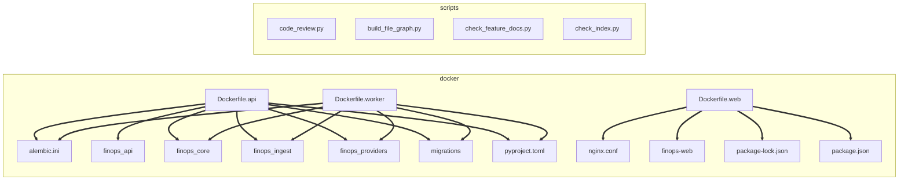

# File dependency graph

Generated by `make graph`. Do not edit by hand.

Every edge is a real dependency read out of the source: a Python import,
a TypeScript import, a Terraform module reference, or a Dockerfile COPY.

18 files, 17 edges.

Interactive version, pan, zoom and filter: `docs/architecture/file-graph.html`

## Edges by kind

| Kind | Count |
| --- | --- |
| docker | 17 |

## Most depended upon

| File | Incoming edges |
| --- | --- |
| `docker/alembic.ini` | 2 |
| `docker/finops_core` | 2 |
| `docker/finops_ingest` | 2 |
| `docker/finops_providers` | 2 |
| `docker/migrations` | 2 |
| `docker/pyproject.toml` | 2 |
| `docker/docker/nginx.conf` | 1 |
| `docker/finops-web` | 1 |
| `docker/finops-web/package-lock.json` | 1 |
| `docker/finops-web/package.json` | 1 |
| `docker/finops_api` | 1 |

## Files with no edges

A file with no edges is either an entry point or dead. Check each one.

- `scripts/ci/code_review.py`
- `scripts/docs/build_file_graph.py`
- `scripts/docs/check_feature_docs.py`
- `scripts/docs/check_index.py`
