# File dependency graph

Generated by `make graph`. Do not edit by hand.

Every edge is a real dependency read out of the source: a Python import,
a TypeScript import, a Terraform module reference, or a Dockerfile COPY.

253 files, 462 edges.

Interactive version, pan, zoom and filter: `docs/architecture/file-graph.html`

```mermaid
graph LR
  subgraph docker["docker"]
    n0["Dockerfile.api"]
    n1["Dockerfile.web"]
    n2["Dockerfile.worker"]
    n3["alembic.ini"]
    n4["nginx.conf"]
    n5["finops-web"]
    n6["package-lock.json"]
    n7["package.json"]
    n8["finops_api"]
    n9["finops_core"]
    n10["finops_ingest"]
    n11["finops_providers"]
    n12["migrations"]
    n13["pyproject.toml"]
  end
  subgraph finops-web["finops-web"]
    n14["vite.config.d.ts"]
    n15["App.d.ts"]
    n16["App.test.d.ts"]
    n17["ApiProvider.d.ts"]
    n18["client.test.d.ts"]
    n19["apiContext.d.ts"]
    n20["client"]
    n21["client.d.ts"]
    n22["queries.d.ts"]
    n23["types"]
    n24["types.d.ts"]
    n25["CoverageBanner"]
    n26["CoverageBanner.d.ts"]
    n27["DataTable"]
    n28["DataTable.d.ts"]
    n29["Figure"]
    n30["Figure.d.ts"]
    n31["FreshnessIndicator"]
    n32["FreshnessIndicator.d.ts"]
    n33["GraphCanvas.d.ts"]
    n34["OrgTree.d.ts"]
    n35["SeverityBadge"]
    n36["SeverityBadge.d.ts"]
    n37["Sparkline"]
    n38["Sparkline.d.ts"]
    n39["StateBoundary"]
    n40["StateBoundary.d.ts"]
    n41["TypedError"]
    n42["TypedError.d.ts"]
    n43["DataTable.test.d.ts"]
    n44["Figure.test.d.ts"]
    n45["GraphCanvas.test.d.ts"]
    n46["OrgTree.test.d.ts"]
    n47["StateBoundary.test.d.ts"]
    n48["axe.d.ts"]
    n49["orgNodes.test.d.ts"]
    n50["shell.test.d.ts"]
    n51["surface.test.d.ts"]
    n52["index.d.ts"]
    n53["orgNodes"]
    n54["orgNodes.d.ts"]
    n55["provenance"]
    n56["provenance.d.ts"]
    n57["surfaceState"]
    n58["surfaceState.d.ts"]
    n59["tableConfig"]
    n60["tableConfig.d.ts"]
    n61["main.d.ts"]
    n62["queryClient.d.ts"]
    n63["AccountsScreen.d.ts"]
    n64["OrganizationScreen.d.ts"]
    n65["AccountsScreen.test.d.ts"]
    n66["Harness.d.ts"]
    n67["OrganizationScreen.test.d.ts"]
    n68["fixtures.d.ts"]
    n69["surfaceStateFor.d.ts"]
    n70["AppShell.d.ts"]
    n71["MetaContext.d.ts"]
    n72["MetaProvider.d.ts"]
    n73["AppShell.test.d.ts"]
    n74["metaStore.test.d.ts"]
    n75["metaRegistry.d.ts"]
    n76["metaStore"]
    n77["metaStore.d.ts"]
    n78["sections"]
    n79["sections.d.ts"]
    n80["test-setup.d.ts"]
    n81["tokens.css"]
    n82["App.test.tsx"]
    n83["App.tsx"]
    n84["ApiProvider.tsx"]
    n85["client.test.ts"]
    n86["apiContext.ts"]
    n87["client.ts"]
    n88["queries.ts"]
    n89["types.ts"]
    n90["CoverageBanner.tsx"]
    n91["DataTable.tsx"]
    n92["Figure.tsx"]
    n93["FreshnessIndicator.tsx"]
    n94["GraphCanvas.tsx"]
    n95["OrgTree.tsx"]
    n96["SeverityBadge.tsx"]
    n97["Sparkline.tsx"]
    n98["StateBoundary.tsx"]
    n99["TypedError.tsx"]
    n100["DataTable.test.tsx"]
    n101["Figure.test.tsx"]
    n102["GraphCanvas.test.tsx"]
    n103["OrgTree.test.tsx"]
    n104["StateBoundary.test.tsx"]
    n105["axe.ts"]
    n106["orgNodes.test.ts"]
    n107["shell.test.tsx"]
    n108["surface.test.ts"]
    n109["index.ts"]
    n110["orgNodes.ts"]
    n111["provenance.ts"]
    n112["surfaceState.ts"]
    n113["tableConfig.ts"]
    n114["main.tsx"]
    n115["queryClient.ts"]
    n116["AccountsScreen.tsx"]
    n117["OrganizationScreen.tsx"]
    n118["AccountsScreen.test.tsx"]
    n119["Harness.tsx"]
    n120["OrganizationScreen.test.tsx"]
    n121["fixtures.ts"]
    n122["surfaceStateFor.ts"]
    n123["AppShell.tsx"]
    n124["MetaProvider.tsx"]
    n125["AppShell.test.tsx"]
    n126["metaStore.test.ts"]
    n127["metaRegistry.ts"]
    n128["metaStore.ts"]
    n129["sections.ts"]
    n130["test-setup.ts"]
    n131["tokens.css"]
    n132["tokens.css?raw"]
    n133["vite-env.d.ts"]
    n134["vite.config.ts"]
  end
  subgraph finops_api["finops_api"]
    n135["__init__.py"]
    n136["__init__.py"]
    n137["models.py"]
    n138["__init__.py"]
    n139["accounts.py"]
    n140["base.py"]
    n141["freshness.py"]
    n142["ingest.py"]
    n143["org.py"]
    n144["deps.py"]
    n145["flags.py"]
    n146["guards.py"]
    n147["__init__.py"]
    n148["coverage.py"]
    n149["local_config.py"]
    n150["session.py"]
    n151["main.py"]
    n152["middleware.py"]
    n153["__init__.py"]
    n154["accounts.py"]
    n155["ingest.py"]
    n156["me.py"]
    n157["org.py"]
    n158["platform.py"]
    n159["schemas.py"]
  end
  subgraph finops_core["finops_core"]
    n160["__init__.py"]
    n161["config.py"]
    n162["constants.py"]
    n163["__init__.py"]
    n164["account.py"]
    n165["cost.py"]
    n166["fact.py"]
    n167["identity.py"]
    n168["ingest.py"]
    n169["metrics.py"]
    n170["org.py"]
    n171["platform.py"]
    n172["quota.py"]
    n173["resource.py"]
    n174["tenant.py"]
    n175["errors.py"]
    n176["__init__.py"]
    n177["accounts.py"]
    n178["cost.py"]
    n179["credentials.py"]
    n180["identity.py"]
    n181["inventory.py"]
    n182["metrics.py"]
    n183["quotas.py"]
  end
  subgraph finops_ingest["finops_ingest"]
    n184["__init__.py"]
    n185["__init__.py"]
    n186["account_health.py"]
    n187["org_tree.py"]
    n188["platform_cost.py"]
    n189["dispatcher.py"]
    n190["ledger.py"]
    n191["registry.py"]
    n192["worker.py"]
  end
  subgraph finops_mcp["finops_mcp"]
    n193["__init__.py"]
  end
  subgraph finops_providers["finops_providers"]
    n194["__init__.py"]
    n195["__init__.py"]
    n196["accounts.py"]
    n197["client.py"]
    n198["credentials.py"]
    n199["health.py"]
    n200["platform_cost.py"]
    n201["__init__.py"]
    n202["fixtures.py"]
    n203["provider.py"]
  end
  subgraph migrations["migrations"]
    n204["env.py"]
    n205["0001_initial.py"]
  end
  subgraph scripts["scripts"]
    n206["check_flags.py"]
    n207["check_forbidden_imports.py"]
    n208["check_hardcoded.py"]
    n209["check_memory.py"]
    n210["code_review.py"]
    n211["refresh_base_images.py"]
    n212["add_lesson.py"]
    n213["build_context_index.py"]
    n214["build_file_graph.py"]
    n215["check_feature_docs.py"]
    n216["check_index.py"]
    n217["rotate_checkpoint.py"]
    n218["sync.py"]
  end
  subgraph tests["tests"]
    n219["__init__.py"]
    n220["__init__.py"]
    n221["test_identity_local.py"]
    n222["test_routes.py"]
    n223["test_scope_enforcement.py"]
    n224["conftest.py"]
    n225["__init__.py"]
    n226["conftest.py"]
    n227["test_account_discovery.py"]
    n228["test_credential_broker.py"]
    n229["__init__.py"]
    n230["test_config.py"]
    n231["test_domain.py"]
    n232["test_errors.py"]
    n233["test_ports.py"]
    n234["__init__.py"]
    n235["test_models.py"]
    n236["test_schema.py"]
    n237["test_scope_guard.py"]
    n238["__init__.py"]
    n239["__init__.py"]
    n240["test_account_health.py"]
    n241["test_org_tree.py"]
    n242["test_platform_cost.py"]
    n243["test_dispatcher.py"]
    n244["test_ledger.py"]
    n245["test_worker.py"]
    n246["__init__.py"]
    n247["__init__.py"]
    n248["test_accounts.py"]
    n249["test_credentials.py"]
    n250["test_health.py"]
    n251["test_fake.py"]
    n252["test_checkpoint_rotation.py"]
  end
  n0 ==> n3
  n0 ==> n8
  n0 ==> n9
  n0 ==> n10
  n0 ==> n11
  n0 ==> n12
  n0 ==> n13
  n1 ==> n4
  n1 ==> n5
  n1 ==> n6
  n1 ==> n7
  n2 ==> n3
  n2 ==> n9
  n2 ==> n10
  n2 ==> n11
  n2 ==> n12
  n2 ==> n13
  n15 --> n20
  n17 --> n20
  n19 --> n20
  n19 --> n23
  n21 --> n23
  n22 --> n23
  n22 --> n53
  n28 --> n59
  n30 --> n55
  n32 --> n55
  n33 --> n53
  n34 --> n53
  n38 --> n55
  n40 --> n57
  n42 --> n55
  n52 --> n25
  n52 --> n27
  n52 --> n29
  n52 --> n31
  n52 --> n35
  n52 --> n37
  n52 --> n39
  n52 --> n41
  n52 --> n55
  n52 --> n57
  n52 --> n59
  n58 --> n55
  n61 --> n81
  n66 --> n20
  n68 --> n20
  n68 --> n23
  n68 --> n53
  n69 --> n23
  n69 --> n57
  n70 --> n78
  n71 --> n23
  n71 --> n76
  n75 --> n23
  n75 --> n76
  n77 --> n23
  n82 --> n83
  n82 --> n87
  n83 --> n84
  n83 --> n87
  n83 --> n115
  n83 --> n116
  n83 --> n117
  n83 --> n123
  n83 --> n124
  n83 --> n129
  n84 --> n86
  n84 --> n87
  n85 --> n87
  n86 --> n87
  n87 --> n89
  n88 --> n86
  n88 --> n89
  n88 --> n110
  n91 --> n113
  n92 --> n93
  n92 --> n99
  n92 --> n111
  n93 --> n111
  n94 --> n110
  n95 --> n110
  n97 --> n111
  n98 --> n99
  n98 --> n112
  n99 --> n111
  n100 --> n91
  n100 --> n105
  n100 --> n113
  n101 --> n92
  n101 --> n105
  n101 --> n111
  n102 --> n94
  n102 --> n110
  n103 --> n95
  n103 --> n105
  n103 --> n110
  n104 --> n98
  n104 --> n105
  n104 --> n112
  n106 --> n110
  n107 --> n90
  n107 --> n93
  n107 --> n96
  n107 --> n97
  n107 --> n99
  n107 --> n105
  n108 --> n109
  n108 --> n132
  n109 --> n90
  n109 --> n91
  n109 --> n92
  n109 --> n93
  n109 --> n96
  n109 --> n97
  n109 --> n98
  n109 --> n99
  n109 --> n111
  n109 --> n112
  n109 --> n113
  n112 --> n111
  n114 --> n83
  n114 --> n87
  n114 --> n131
  n116 --> n88
  n116 --> n89
  n116 --> n91
  n116 --> n98
  n116 --> n113
  n116 --> n122
  n116 --> n127
  n117 --> n88
  n117 --> n94
  n117 --> n95
  n117 --> n98
  n117 --> n122
  n117 --> n127
  n118 --> n116
  n118 --> n119
  n118 --> n121
  n119 --> n84
  n119 --> n87
  n119 --> n124
  n120 --> n117
  n120 --> n119
  n120 --> n121
  n121 --> n87
  n121 --> n89
  n121 --> n110
  n122 --> n89
  n122 --> n111
  n122 --> n112
  n123 --> n90
  n123 --> n93
  n123 --> n99
  n123 --> n111
  n123 --> n127
  n123 --> n129
  n124 --> n89
  n124 --> n127
  n124 --> n128
  n125 --> n89
  n125 --> n105
  n125 --> n123
  n125 --> n124
  n125 --> n127
  n126 --> n89
  n126 --> n128
  n127 --> n89
  n127 --> n128
  n128 --> n89
  n138 --> n139
  n138 --> n140
  n138 --> n141
  n138 --> n142
  n138 --> n143
  n139 --> n136
  n139 --> n140
  n139 --> n146
  n139 --> n174
  n140 --> n135
  n140 --> n136
  n140 --> n146
  n140 --> n174
  n141 --> n136
  n141 --> n140
  n141 --> n174
  n142 --> n136
  n142 --> n140
  n142 --> n174
  n143 --> n136
  n143 --> n140
  n143 --> n174
  n144 --> n140
  n144 --> n161
  n144 --> n167
  n144 --> n174
  n144 --> n175
  n145 --> n161
  n145 --> n162
  n146 --> n174
  n147 --> n148
  n147 --> n149
  n147 --> n150
  n149 --> n164
  n149 --> n167
  n149 --> n174
  n149 --> n175
  n150 --> n164
  n150 --> n174
  n150 --> n175
  n151 --> n144
  n151 --> n146
  n151 --> n152
  n151 --> n153
  n151 --> n159
  n151 --> n161
  n151 --> n162
  n152 --> n144
  n153 --> n138
  n153 --> n159
  n153 --> n174
  n154 --> n138
  n154 --> n144
  n154 --> n153
  n154 --> n159
  n154 --> n164
  n154 --> n174
  n155 --> n138
  n155 --> n144
  n155 --> n153
  n155 --> n159
  n155 --> n162
  n155 --> n174
  n156 --> n138
  n156 --> n144
  n156 --> n153
  n156 --> n159
  n156 --> n167
  n156 --> n174
  n157 --> n138
  n157 --> n144
  n157 --> n153
  n157 --> n159
  n157 --> n164
  n157 --> n170
  n157 --> n174
  n158 --> n138
  n158 --> n144
  n158 --> n153
  n158 --> n159
  n158 --> n174
  n161 --> n162
  n163 --> n164
  n163 --> n165
  n163 --> n166
  n163 --> n167
  n163 --> n168
  n163 --> n170
  n163 --> n171
  n163 --> n174
  n164 --> n166
  n165 --> n166
  n167 --> n166
  n167 --> n174
  n168 --> n164
  n168 --> n166
  n169 --> n164
  n169 --> n166
  n170 --> n164
  n170 --> n166
  n171 --> n166
  n172 --> n164
  n172 --> n166
  n173 --> n164
  n173 --> n166
  n174 --> n164
  n176 --> n177
  n176 --> n178
  n176 --> n179
  n176 --> n180
  n176 --> n181
  n176 --> n182
  n176 --> n183
  n177 --> n164
  n177 --> n170
  n178 --> n165
  n179 --> n164
  n180 --> n167
  n181 --> n164
  n181 --> n173
  n182 --> n164
  n182 --> n169
  n183 --> n164
  n183 --> n172
  n186 --> n164
  n186 --> n175
  n186 --> n191
  n187 --> n164
  n187 --> n170
  n187 --> n175
  n187 --> n191
  n188 --> n171
  n188 --> n191
  n189 --> n164
  n189 --> n190
  n189 --> n191
  n190 --> n175
  n192 --> n162
  n192 --> n175
  n192 --> n189
  n192 --> n190
  n192 --> n191
  n195 --> n196
  n195 --> n198
  n195 --> n199
  n195 --> n200
  n196 --> n161
  n196 --> n162
  n196 --> n164
  n196 --> n170
  n196 --> n175
  n196 --> n197
  n197 --> n161
  n197 --> n175
  n198 --> n161
  n198 --> n162
  n198 --> n164
  n198 --> n197
  n199 --> n164
  n199 --> n175
  n200 --> n161
  n200 --> n162
  n200 --> n197
  n201 --> n203
  n202 --> n164
  n202 --> n165
  n202 --> n167
  n202 --> n169
  n202 --> n170
  n202 --> n172
  n202 --> n173
  n202 --> n175
  n203 --> n164
  n203 --> n165
  n203 --> n167
  n203 --> n169
  n203 --> n170
  n203 --> n172
  n203 --> n173
  n203 --> n174
  n203 --> n175
  n203 --> n201
  n204 --> n137
  n204 --> n161
  n221 --> n147
  n221 --> n164
  n221 --> n167
  n221 --> n174
  n221 --> n175
  n222 --> n147
  n222 --> n151
  n222 --> n161
  n222 --> n164
  n222 --> n167
  n222 --> n174
  n222 --> n191
  n223 --> n138
  n223 --> n144
  n223 --> n147
  n223 --> n151
  n223 --> n159
  n223 --> n161
  n223 --> n164
  n223 --> n167
  n223 --> n174
  n223 --> n191
  n224 --> n161
  n226 --> n161
  n226 --> n164
  n226 --> n196
  n226 --> n198
  n226 --> n201
  n226 --> n203
  n227 --> n164
  n227 --> n170
  n228 --> n160
  n230 --> n145
  n230 --> n161
  n231 --> n163
  n231 --> n164
  n231 --> n165
  n231 --> n166
  n231 --> n167
  n231 --> n168
  n231 --> n169
  n231 --> n170
  n231 --> n172
  n231 --> n173
  n231 --> n174
  n232 --> n160
  n233 --> n160
  n235 --> n136
  n235 --> n160
  n235 --> n164
  n235 --> n170
  n236 --> n136
  n237 --> n136
  n237 --> n138
  n237 --> n146
  n237 --> n164
  n237 --> n174
  n240 --> n164
  n240 --> n175
  n240 --> n186
  n240 --> n189
  n240 --> n191
  n241 --> n164
  n241 --> n170
  n241 --> n175
  n241 --> n187
  n241 --> n189
  n241 --> n191
  n242 --> n161
  n242 --> n162
  n242 --> n171
  n242 --> n175
  n242 --> n188
  n242 --> n189
  n242 --> n191
  n242 --> n200
  n243 --> n164
  n243 --> n189
  n243 --> n190
  n243 --> n191
  n244 --> n175
  n244 --> n190
  n245 --> n164
  n245 --> n175
  n245 --> n189
  n245 --> n191
  n245 --> n192
  n248 --> n160
  n248 --> n161
  n248 --> n164
  n248 --> n170
  n248 --> n175
  n248 --> n196
  n249 --> n161
  n249 --> n162
  n249 --> n164
  n249 --> n175
  n249 --> n197
  n249 --> n198
  n250 --> n164
  n250 --> n175
  n250 --> n199
  n251 --> n160
  n251 --> n164
  n251 --> n170
  n251 --> n201
  n251 --> n203
```

## Edges by kind

| Kind | Count |
| --- | --- |
| docker | 17 |
| python | 291 |
| typescript | 154 |

## Most depended upon

| File | Incoming edges |
| --- | --- |
| `finops_core/domain/account.py` | 40 |
| `finops_core/domain/tenant.py` | 23 |
| `finops_core/errors.py` | 21 |
| `finops_core/config.py` | 16 |
| `finops_core/domain/org.py` | 13 |
| `finops_ingest/registry.py` | 12 |
| `finops_core/domain/fact.py` | 11 |
| `finops_core/domain/identity.py` | 11 |
| `finops-web/src/api/types.ts` | 10 |
| `finops_core/constants.py` | 10 |
| `finops-web/src/components/provenance.ts` | 9 |
| `finops-web/dist-types/src/api/types` | 8 |
| `finops-web/src/api/client.ts` | 8 |
| `finops_api/db/__init__.py` | 8 |
| `finops_api/db/repositories/__init__.py` | 8 |

## Files with no edges

A file with no edges is either an entry point or dead. Check each one.

- `finops-web/dist-types-node/vite.config.d.ts`
- `finops-web/dist-types/src/App.test.d.ts`
- `finops-web/dist-types/src/api/__tests__/client.test.d.ts`
- `finops-web/dist-types/src/api/types.d.ts`
- `finops-web/dist-types/src/components/CoverageBanner.d.ts`
- `finops-web/dist-types/src/components/SeverityBadge.d.ts`
- `finops-web/dist-types/src/components/__tests__/DataTable.test.d.ts`
- `finops-web/dist-types/src/components/__tests__/Figure.test.d.ts`
- `finops-web/dist-types/src/components/__tests__/GraphCanvas.test.d.ts`
- `finops-web/dist-types/src/components/__tests__/OrgTree.test.d.ts`
- `finops-web/dist-types/src/components/__tests__/StateBoundary.test.d.ts`
- `finops-web/dist-types/src/components/__tests__/axe.d.ts`
- `finops-web/dist-types/src/components/__tests__/orgNodes.test.d.ts`
- `finops-web/dist-types/src/components/__tests__/shell.test.d.ts`
- `finops-web/dist-types/src/components/__tests__/surface.test.d.ts`
- `finops-web/dist-types/src/components/orgNodes.d.ts`
- `finops-web/dist-types/src/components/provenance.d.ts`
- `finops-web/dist-types/src/components/tableConfig.d.ts`
- `finops-web/dist-types/src/queryClient.d.ts`
- `finops-web/dist-types/src/screens/AccountsScreen.d.ts`
- `finops-web/dist-types/src/screens/OrganizationScreen.d.ts`
- `finops-web/dist-types/src/screens/__tests__/AccountsScreen.test.d.ts`
- `finops-web/dist-types/src/screens/__tests__/OrganizationScreen.test.d.ts`
- `finops-web/dist-types/src/shell/MetaProvider.d.ts`
- `finops-web/dist-types/src/shell/__tests__/AppShell.test.d.ts`
- `finops-web/dist-types/src/shell/__tests__/metaStore.test.d.ts`
- `finops-web/dist-types/src/shell/sections.d.ts`
- `finops-web/dist-types/src/test-setup.d.ts`
- `finops-web/src/test-setup.ts`
- `finops-web/src/vite-env.d.ts`
- `finops-web/vite.config.ts`
- `finops_ingest/__init__.py`
- `finops_ingest/collectors/__init__.py`
- `finops_mcp/__init__.py`
- `finops_providers/__init__.py`
- `migrations/versions/0001_initial.py`
- `scripts/ci/check_flags.py`
- `scripts/ci/check_forbidden_imports.py`
- `scripts/ci/check_hardcoded.py`
- `scripts/ci/check_memory.py`
