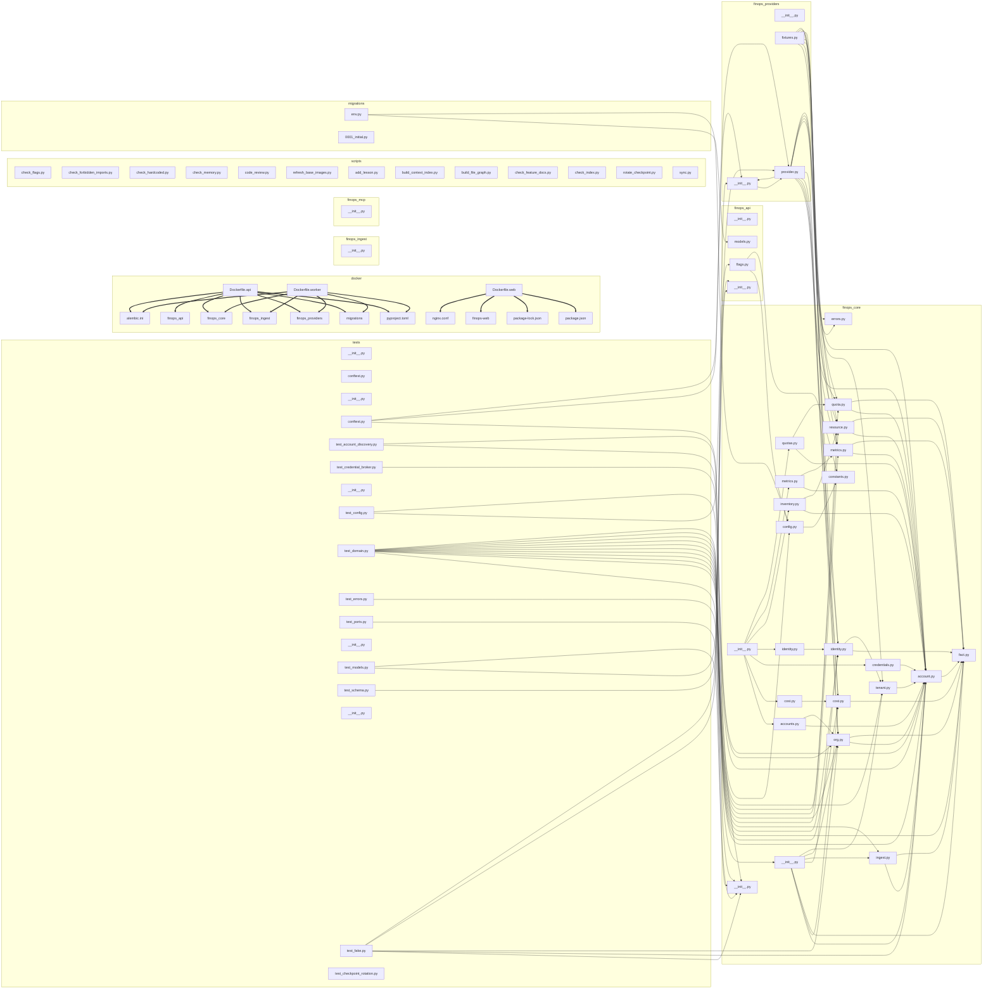

# File dependency graph

Generated by `make graph`. Do not edit by hand.

Every edge is a real dependency read out of the source: a Python import,
a TypeScript import, a Terraform module reference, or a Dockerfile COPY.

79 files, 110 edges.

Interactive version, pan, zoom and filter: `docs/architecture/file-graph.html`

## Edges by kind

| Kind | Count |
| --- | --- |
| docker | 17 |
| python | 93 |

## Most depended upon

| File | Incoming edges |
| --- | --- |
| `finops_core/domain/account.py` | 18 |
| `finops_core/domain/fact.py` | 10 |
| `finops_core/domain/org.py` | 7 |
| `finops_core/__init__.py` | 5 |
| `finops_core/domain/cost.py` | 5 |
| `finops_core/domain/identity.py` | 5 |
| `finops_core/domain/metrics.py` | 4 |
| `finops_core/domain/quota.py` | 4 |
| `finops_core/domain/resource.py` | 4 |
| `finops_core/domain/tenant.py` | 4 |
| `finops_core/config.py` | 3 |
| `finops_providers/fake/__init__.py` | 3 |
| `finops_providers/fake/provider.py` | 3 |
| `docker/alembic.ini` | 2 |
| `docker/finops_core` | 2 |

## Files with no edges

A file with no edges is either an entry point or dead. Check each one.

- `finops_api/__init__.py`
- `finops_ingest/__init__.py`
- `finops_mcp/__init__.py`
- `finops_providers/__init__.py`
- `migrations/versions/0001_initial.py`
- `scripts/ci/check_flags.py`
- `scripts/ci/check_forbidden_imports.py`
- `scripts/ci/check_hardcoded.py`
- `scripts/ci/check_memory.py`
- `scripts/ci/code_review.py`
- `scripts/ci/refresh_base_images.py`
- `scripts/docs/add_lesson.py`
- `scripts/docs/build_context_index.py`
- `scripts/docs/build_file_graph.py`
- `scripts/docs/check_feature_docs.py`
- `scripts/docs/check_index.py`
- `scripts/docs/rotate_checkpoint.py`
- `scripts/docs/sync.py`
- `tests/__init__.py`
- `tests/conftest.py`
- `tests/contract/__init__.py`
- `tests/core/__init__.py`
- `tests/db/__init__.py`
- `tests/providers/__init__.py`
- `tests/test_checkpoint_rotation.py`
