# File dependency graph

Generated by `make graph`. Do not edit by hand.

Every edge is a real dependency read out of the source: a Python import,
a TypeScript import, a Terraform module reference, or a Dockerfile COPY.

116 files, 224 edges.

Interactive version, pan, zoom and filter: `docs/architecture/file-graph.html`

```mermaid
graph LR
  subgraph docker["docker"]
    n0["Dockerfile.api"]
    n1["Dockerfile.web"]
    n2["Dockerfile.worker"]
    n3["alembic.ini"]
    n4["nginx.conf"]
    n5["finops-web"]
    n6["package-lock.json"]
    n7["package.json"]
    n8["finops_api"]
    n9["finops_core"]
    n10["finops_ingest"]
    n11["finops_providers"]
    n12["migrations"]
    n13["pyproject.toml"]
  end
  subgraph finops_api["finops_api"]
    n14["__init__.py"]
    n15["__init__.py"]
    n16["models.py"]
    n17["__init__.py"]
    n18["accounts.py"]
    n19["base.py"]
    n20["ingest.py"]
    n21["org.py"]
    n22["flags.py"]
    n23["guards.py"]
    n24["__init__.py"]
    n25["coverage.py"]
    n26["local_config.py"]
    n27["session.py"]
  end
  subgraph finops_core["finops_core"]
    n28["__init__.py"]
    n29["config.py"]
    n30["constants.py"]
    n31["__init__.py"]
    n32["account.py"]
    n33["cost.py"]
    n34["fact.py"]
    n35["identity.py"]
    n36["ingest.py"]
    n37["metrics.py"]
    n38["org.py"]
    n39["quota.py"]
    n40["resource.py"]
    n41["tenant.py"]
    n42["errors.py"]
    n43["__init__.py"]
    n44["accounts.py"]
    n45["cost.py"]
    n46["credentials.py"]
    n47["identity.py"]
    n48["inventory.py"]
    n49["metrics.py"]
    n50["quotas.py"]
  end
  subgraph finops_ingest["finops_ingest"]
    n51["__init__.py"]
    n52["__init__.py"]
    n53["account_health.py"]
    n54["org_tree.py"]
    n55["dispatcher.py"]
    n56["ledger.py"]
    n57["registry.py"]
    n58["worker.py"]
  end
  subgraph finops_mcp["finops_mcp"]
    n59["__init__.py"]
  end
  subgraph finops_providers["finops_providers"]
    n60["__init__.py"]
    n61["__init__.py"]
    n62["accounts.py"]
    n63["client.py"]
    n64["credentials.py"]
    n65["health.py"]
    n66["__init__.py"]
    n67["fixtures.py"]
    n68["provider.py"]
  end
  subgraph migrations["migrations"]
    n69["env.py"]
    n70["0001_initial.py"]
  end
  subgraph scripts["scripts"]
    n71["check_flags.py"]
    n72["check_forbidden_imports.py"]
    n73["check_hardcoded.py"]
    n74["check_memory.py"]
    n75["code_review.py"]
    n76["refresh_base_images.py"]
    n77["add_lesson.py"]
    n78["build_context_index.py"]
    n79["build_file_graph.py"]
    n80["check_feature_docs.py"]
    n81["check_index.py"]
    n82["rotate_checkpoint.py"]
    n83["sync.py"]
  end
  subgraph tests["tests"]
    n84["__init__.py"]
    n85["__init__.py"]
    n86["test_identity_local.py"]
    n87["conftest.py"]
    n88["__init__.py"]
    n89["conftest.py"]
    n90["test_account_discovery.py"]
    n91["test_credential_broker.py"]
    n92["__init__.py"]
    n93["test_config.py"]
    n94["test_domain.py"]
    n95["test_errors.py"]
    n96["test_ports.py"]
    n97["__init__.py"]
    n98["test_models.py"]
    n99["test_schema.py"]
    n100["test_scope_guard.py"]
    n101["__init__.py"]
    n102["__init__.py"]
    n103["test_account_health.py"]
    n104["test_org_tree.py"]
    n105["test_dispatcher.py"]
    n106["test_ledger.py"]
    n107["test_worker.py"]
    n108["__init__.py"]
    n109["__init__.py"]
    n110["conftest.py"]
    n111["test_accounts.py"]
    n112["test_credentials.py"]
    n113["test_health.py"]
    n114["test_fake.py"]
    n115["test_checkpoint_rotation.py"]
  end
  n0 ==> n3
  n0 ==> n8
  n0 ==> n9
  n0 ==> n10
  n0 ==> n11
  n0 ==> n12
  n0 ==> n13
  n1 ==> n4
  n1 ==> n5
  n1 ==> n6
  n1 ==> n7
  n2 ==> n3
  n2 ==> n9
  n2 ==> n10
  n2 ==> n11
  n2 ==> n12
  n2 ==> n13
  n17 --> n18
  n17 --> n19
  n17 --> n20
  n17 --> n21
  n18 --> n15
  n18 --> n19
  n18 --> n41
  n19 --> n14
  n19 --> n15
  n19 --> n23
  n19 --> n41
  n20 --> n15
  n20 --> n19
  n20 --> n41
  n21 --> n15
  n21 --> n19
  n21 --> n41
  n22 --> n29
  n22 --> n30
  n23 --> n41
  n24 --> n25
  n24 --> n26
  n24 --> n27
  n26 --> n32
  n26 --> n35
  n26 --> n41
  n26 --> n42
  n27 --> n32
  n27 --> n41
  n27 --> n42
  n29 --> n30
  n31 --> n32
  n31 --> n33
  n31 --> n34
  n31 --> n35
  n31 --> n36
  n31 --> n38
  n31 --> n41
  n32 --> n34
  n33 --> n34
  n35 --> n34
  n35 --> n41
  n36 --> n32
  n36 --> n34
  n37 --> n32
  n37 --> n34
  n38 --> n32
  n38 --> n34
  n39 --> n32
  n39 --> n34
  n40 --> n32
  n40 --> n34
  n41 --> n32
  n43 --> n44
  n43 --> n45
  n43 --> n46
  n43 --> n47
  n43 --> n48
  n43 --> n49
  n43 --> n50
  n44 --> n32
  n44 --> n38
  n45 --> n33
  n46 --> n32
  n47 --> n35
  n48 --> n32
  n48 --> n40
  n49 --> n32
  n49 --> n37
  n50 --> n32
  n50 --> n39
  n53 --> n32
  n53 --> n42
  n53 --> n57
  n54 --> n32
  n54 --> n38
  n54 --> n42
  n54 --> n57
  n55 --> n32
  n55 --> n56
  n55 --> n57
  n56 --> n42
  n58 --> n30
  n58 --> n42
  n58 --> n55
  n58 --> n56
  n58 --> n57
  n61 --> n62
  n61 --> n64
  n61 --> n65
  n62 --> n29
  n62 --> n30
  n62 --> n32
  n62 --> n38
  n62 --> n42
  n62 --> n63
  n63 --> n29
  n63 --> n42
  n64 --> n29
  n64 --> n30
  n64 --> n32
  n64 --> n63
  n65 --> n32
  n65 --> n42
  n66 --> n68
  n67 --> n32
  n67 --> n33
  n67 --> n35
  n67 --> n37
  n67 --> n38
  n67 --> n39
  n67 --> n40
  n67 --> n42
  n68 --> n32
  n68 --> n33
  n68 --> n35
  n68 --> n37
  n68 --> n38
  n68 --> n39
  n68 --> n40
  n68 --> n41
  n68 --> n42
  n68 --> n66
  n69 --> n16
  n69 --> n29
  n86 --> n24
  n86 --> n32
  n86 --> n35
  n86 --> n41
  n86 --> n42
  n89 --> n29
  n89 --> n32
  n89 --> n62
  n89 --> n64
  n89 --> n66
  n89 --> n68
  n90 --> n32
  n90 --> n38
  n91 --> n28
  n93 --> n22
  n93 --> n29
  n94 --> n31
  n94 --> n32
  n94 --> n33
  n94 --> n34
  n94 --> n35
  n94 --> n36
  n94 --> n37
  n94 --> n38
  n94 --> n39
  n94 --> n40
  n94 --> n41
  n95 --> n28
  n96 --> n28
  n98 --> n15
  n98 --> n28
  n98 --> n32
  n98 --> n38
  n99 --> n15
  n100 --> n15
  n100 --> n17
  n100 --> n23
  n100 --> n32
  n100 --> n41
  n103 --> n32
  n103 --> n42
  n103 --> n53
  n103 --> n55
  n103 --> n57
  n104 --> n32
  n104 --> n38
  n104 --> n42
  n104 --> n54
  n104 --> n55
  n104 --> n57
  n105 --> n32
  n105 --> n55
  n105 --> n56
  n105 --> n57
  n106 --> n42
  n106 --> n56
  n107 --> n32
  n107 --> n42
  n107 --> n55
  n107 --> n57
  n107 --> n58
  n110 --> n29
  n111 --> n28
  n111 --> n29
  n111 --> n32
  n111 --> n38
  n111 --> n42
  n111 --> n62
  n112 --> n29
  n112 --> n30
  n112 --> n32
  n112 --> n42
  n112 --> n63
  n112 --> n64
  n113 --> n32
  n113 --> n42
  n113 --> n65
  n114 --> n28
  n114 --> n32
  n114 --> n38
  n114 --> n66
  n114 --> n68
```

## Edges by kind

| Kind | Count |
| --- | --- |
| docker | 17 |
| python | 207 |

## Most depended upon

| File | Incoming edges |
| --- | --- |
| `finops_core/domain/account.py` | 36 |
| `finops_core/errors.py` | 19 |
| `finops_core/domain/tenant.py` | 13 |
| `finops_core/domain/org.py` | 12 |
| `finops_core/config.py` | 10 |
| `finops_core/domain/fact.py` | 10 |
| `finops_ingest/registry.py` | 8 |
| `finops_api/db/__init__.py` | 7 |
| `finops_core/domain/identity.py` | 7 |
| `finops_core/__init__.py` | 6 |
| `finops_core/constants.py` | 6 |
| `finops_core/domain/cost.py` | 5 |
| `finops_ingest/dispatcher.py` | 5 |
| `finops_api/db/repositories/base.py` | 4 |
| `finops_core/domain/metrics.py` | 4 |

## Files with no edges

A file with no edges is either an entry point or dead. Check each one.

- `finops_ingest/__init__.py`
- `finops_ingest/collectors/__init__.py`
- `finops_mcp/__init__.py`
- `finops_providers/__init__.py`
- `migrations/versions/0001_initial.py`
- `scripts/ci/check_flags.py`
- `scripts/ci/check_forbidden_imports.py`
- `scripts/ci/check_hardcoded.py`
- `scripts/ci/check_memory.py`
- `scripts/ci/code_review.py`
- `scripts/ci/refresh_base_images.py`
- `scripts/docs/add_lesson.py`
- `scripts/docs/build_context_index.py`
- `scripts/docs/build_file_graph.py`
- `scripts/docs/check_feature_docs.py`
- `scripts/docs/check_index.py`
- `scripts/docs/rotate_checkpoint.py`
- `scripts/docs/sync.py`
- `tests/__init__.py`
- `tests/api/__init__.py`
- `tests/conftest.py`
- `tests/contract/__init__.py`
- `tests/core/__init__.py`
- `tests/db/__init__.py`
- `tests/ingest/__init__.py`
- `tests/ingest/collectors/__init__.py`
- `tests/providers/__init__.py`
- `tests/providers/aws/__init__.py`
- `tests/test_checkpoint_rotation.py`
